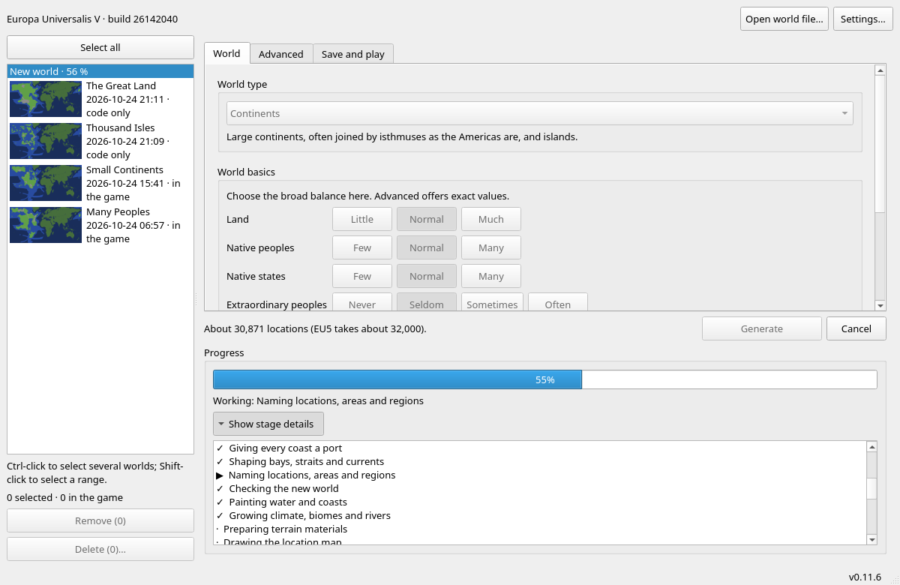
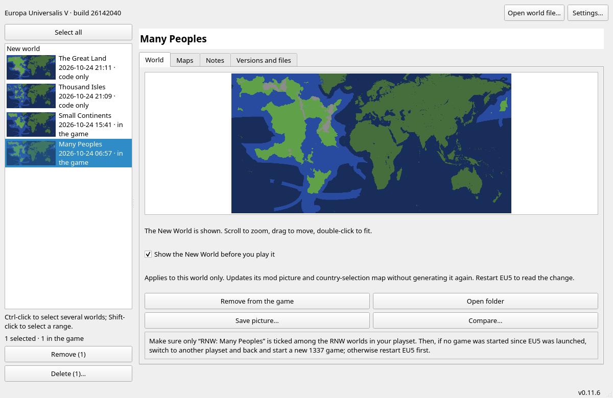
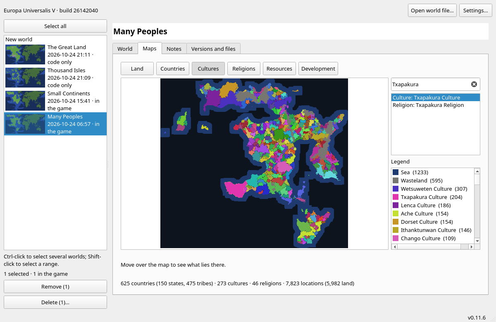
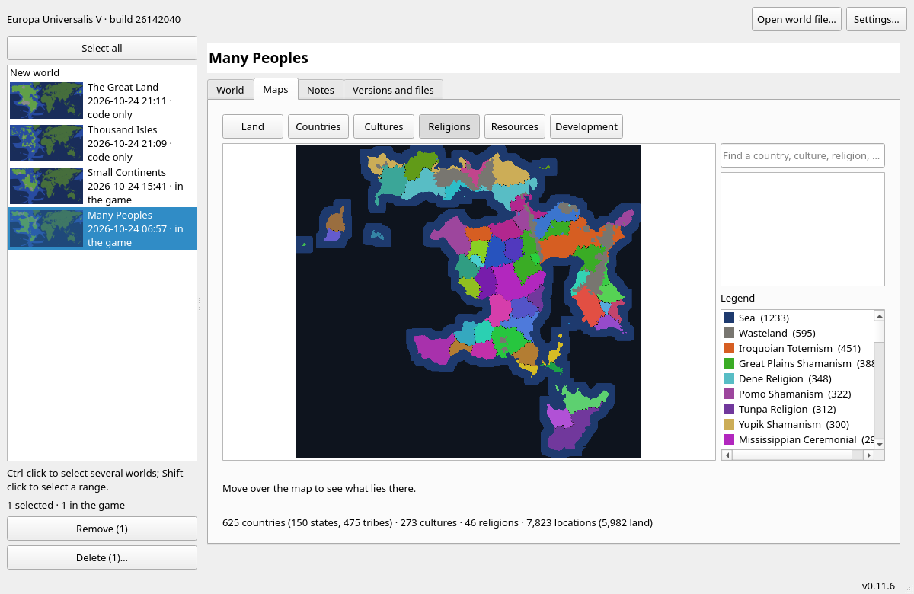
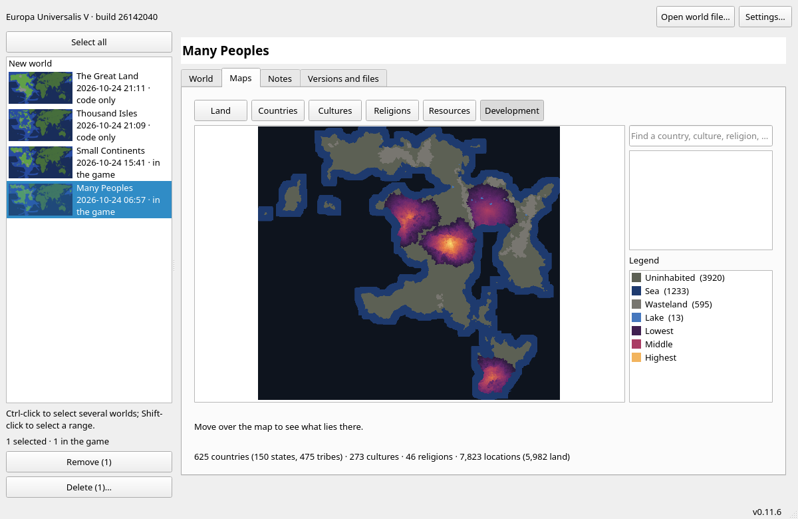
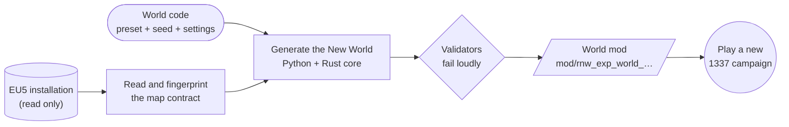

<div align="center">


# Random New World for Europa Universalis V

**A generator that replaces the Americas with a procedurally generated New World and leaves the Old World as Paradox made it.**

[](https://github.com/Sir-Starch/eu5-random-new-world/actions/workflows/check.yml)
[](LICENSE)


</div>

---

Each seed produces new continents, coastlines, relief, climate, rivers, seas, resources, provinces and native civilisations. The generator writes them as an ordinary EU5 mod. Every world is a self-contained map mod, has a short **world code**, and can be rebuilt byte for byte from that code with the same game version.

> [!IMPORTANT]
> **Pre-release (0.x).** No public release or Workshop item exists yet. The maintainer has played much of the generated New World in game; see [`CHANGELOG.md`](CHANGELOG.md) and the [experiment records](experiments/). Expect breaking changes until 1.0.0, the first Steam Workshop publication ([ADR 0003](docs/adr/0003-versioning.md)).

## Features

| Layer | What the generator makes |
|---|---|
| **Land** | Five world types (supercontinent, continents, small continents, archipelago, scattered islands), coastlines that follow the seed, an optional land outline you draw yourself |
| **Physical world** | Relief, climate, biomes, terrain materials and vegetation from one model; rivers from drainage; vanilla-calibrated coast and shelf profiles |
| **Seas** | One port for every coastal sea zone; names taken from the water's shape (gulfs, straits, capes, island waters); depth and topography; ocean lanes and currents that continue the game's own; strait crossings armies can use |
| **Political map** | Compact, connected locations, provinces, areas and regions. The original American region and area keys are matched to the generated ones by physical similarity |
| **Peoples** | Native cultures and religions with homelands, states, tribes and vassals; rare great empires, sea leagues, highland confederations, fractured realms and sacred centres, each with causes and weaknesses |
| **Economy** | Start development, harbours, market villages and technology levels derived from each society |
| **Content** | Stories and formable countries planned from the finished world; colonial names built from each region's generated name; the historical American content is rebound, neutralised or replaced decision by decision |
| **Before you play** | The New World stays terra incognita in the generator, in the game's mod list and at country selection until you choose to see it |

## Screenshots

The generator's window (Qt, the platform's own controls) on a demo library. The New World stays covered until you choose to show it; the pictures of the worlds here have been shown.

<table>
<tr>
<td width="50%"><br><sub>Pick a world type and a few broad choices; exact values are one tab away.</sub></td>
<td width="50%"><br><sub>Or set every value by hand, within the range that still plays.</sub></td>
</tr>
<tr>
<td width="50%"><br><sub>A world takes a few minutes; every stage is shown and the work can be cancelled.</sub></td>
<td width="50%"><br><sub>Every world is kept in the library, with its picture, notes and versions.</sub></td>
</tr>
<tr>
<td width="50%"><br><sub>Maps of the finished world: cultures, with a search for any people, country or place.</sub></td>
<td width="50%"><br><sub>Religions, countries, resources and development have their own layers.</sub></td>
</tr>
<tr>
<td width="50%"><br><sub>Where the peoples are many and where the land is empty.</sub></td>
<td width="50%"><br><sub>By default the New World stays terra incognita, here and in the game, until you play it.</sub></td>
</tr>
</table>

*Europa Universalis V* is © Paradox Interactive AB. The Old World in these pictures is the game's own map; the New World is generated. The screenshots illustrate this unofficial mod and generator.

## How it works

EU5 builds its map from files when it loads mods. A mod is data: it cannot run code, and script cannot create land, mountains or rivers. The generation therefore runs in a separate program that reads the player's own installation and writes a mod. The generator does not change or hook into the game.



- **Old World preserved.** Pixels, keys and contacts outside the New World canvas are checked against the installed game.
- **Deterministic.** The same code, generator version and game build give identical files on any machine, with any thread count. A reference world's digest is pinned in the test suite.
- **Fails loudly.** An unknown game build, an undecided vanilla script object or a broken invariant stops the export. No output is silently repaired.
- **Native core.** Hot kernels (noise, distance fields, drainage, terrain slots, LZAV) are in Rust and bit-identical to the Python reference implementations in [`tests/reference/`](tests/reference/).

See [architecture](docs/architecture.md), [ADR 0009](docs/adr/0009-hub-mod-with-generator.md) (delivery) and [ADR 0010](docs/adr/0010-layered-worlds-and-a-generator-of-its-own.md) (layered, reproducible worlds) for the design.

## Getting started

### Requirements

- **Europa Universalis V 1.4.x**, installed through Steam (Windows, or Linux through Proton). The generator checks the installed build and refuses one it has not been verified against.
- **Python 3.12+** and [**uv**](https://docs.astral.sh/uv/).
- A stable **Rust** toolchain ([rustup](https://rustup.rs/)) to build the native core.
- About **7.5 GB of free memory** while a world is generated, which takes a few minutes.

### Run from source

```sh
git clone https://github.com/Sir-Starch/eu5-random-new-world.git
cd eu5-random-new-world
uv sync --locked --group dev     # builds the Rust extension as part of the package
uv run rnw gui                   # the generator's window
```

The window finds EU5 and your profile on its own. Missing folders can be chosen under *Settings*. From the command line:

```sh
uv run rnw find-game                                      # installations and profiles found (read only)
uv run rnw world-code --preset small_continents --seed 42 # print a world code
uv run rnw world CODE --install                           # build that world and add it to the game
uv run rnw worlds                                         # the worlds you have made
uv run rnw --help                                         # everything else
```

### Play a world

1. Generate a world. It appears in the game's mod list as **RNW: *type* *tag*** (for example *RNW: Small continents 7K3Q*).
2. In the EU5 launcher, enable that world in a playset, **one world at a time**.
3. Start a **new 1337 campaign**. If you have already played a campaign in this session, restart EU5 first: the engine crashes when a different world starts after a campaign in the same process.

The [generator guide](docs/generator-guide.md) covers world files, rerolls, queues and the atlas.

## Documentation

The [documentation index](docs/README.md) lists everything. The main entry points:

- **Using it:** [generator guide](docs/generator-guide.md), [product specification](docs/product-spec.md)
- **Design:** [architecture](docs/architecture.md), [natives](docs/natives.md), [economy](docs/economy.md), [sea geography](docs/sea-geography.md), [terrain and biomes](docs/terrain-biomes.md), [content plan](docs/content-plan.md), [decision records](docs/adr/)
- **Progress:** [roadmap](docs/roadmap.md), [changelog](CHANGELOG.md), [experiments](experiments/README.md)
- **Evidence:** [findings](docs/research/findings.md), [claims ledger](docs/research/claims-ledger.md), [interoperability register](docs/research/interoperability.md)

## Development

```sh
uv sync --locked --group dev
make check        # ruff format + lint, basedpyright, pytest, cargo fmt/clippy/test
```

CI runs the same checks on Linux and Windows. Tests use synthetic fixtures and need no game. With a local installation, `EU5_GAME_DIR=/path/to/game uv run pytest -q tests/test_local_install.py` adds read-only checks against it.

| Path | Contents |
|---|---|
| [`src/rnw/`](src/rnw/) | The generator: world model, geography, seas, peoples, content, EU5 exporters, validators, CLI |
| [`src/rnw/app/`](src/rnw/app/), [`src/rnw/gui/`](src/rnw/gui/) | Headless application core and the Qt window |
| [`native/`](native/) | Rust crate behind `rnw._native` |
| [`packaging/`](packaging/) | Application and Workshop-item builds, release tooling, third-party notices |
| [`tests/`](tests/) | Test suite, Python reference kernels, golden digests |
| [`docs/`](docs/), [`experiments/`](experiments/) | Design, decisions, evidence and in-game experiment records |

Contributions are welcome. Read [CONTRIBUTING.md](CONTRIBUTING.md) first. In particular, **never commit files from the game or anything derived from them.** [AGENTS.md](AGENTS.md) holds the project's working rules, which coding agents read too.

## Legal

*Europa Universalis* and *Paradox Interactive* are trademarks of Paradox Interactive AB. This project is **not affiliated with or endorsed by Paradox Interactive**.

This repository contains no game files. A generated world is built on your computer from your own copy of the game. It contains material derived from the game, is not covered by this project's licence, and is subject to [Paradox's user agreement](https://legal.paradoxplaza.com/eula). See [legal notes](docs/legal.md) for the reasoning and open questions.

The code and mod files are licensed under the [Mozilla Public License 2.0](LICENSE). Bundled third-party components keep their own licences ([notices](packaging/THIRD_PARTY_NOTICES.md)). To report a vulnerability, follow [SECURITY.md](SECURITY.md).
