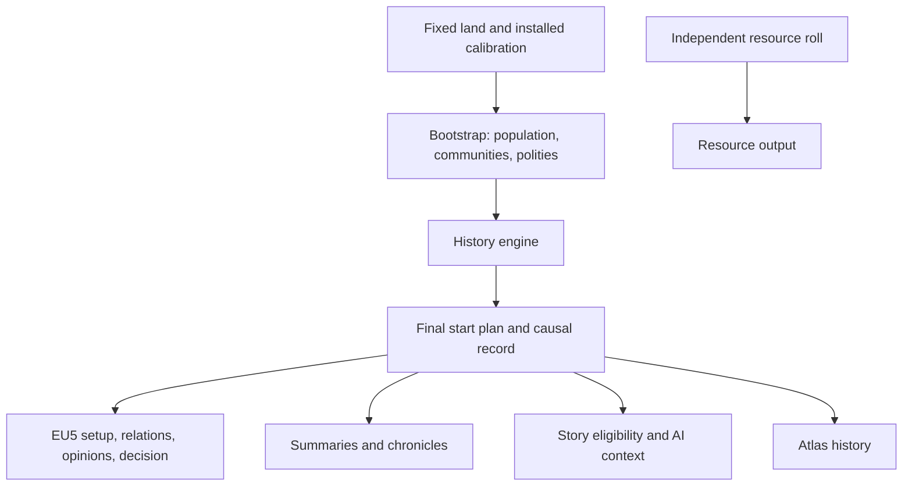

# RNW 1.2.0 plan: history, geopolitics and distinctive societies

**Status: accepted plan (owner instruction, 2026-11-02).** The owner asked for the
plan to be completed without open questions and committed. It is the design
reference for 1.2.0 work. **Implementation was authorized by the owner on
2026-11-03.** **Revised by the owner-authorized audit of 2026-11-05**
([§21](#21-independent-audit-and-redesign-2026-11-05)). Its decisions D21–D28
rewrite the policy targets, the acceptance criteria ([§18](#18-acceptance-criteria))
and the remaining phases (R1–R6). Version/epoch changes follow the phase
requirements below; publication still requires explicit authorization under
[AGENTS](../AGENTS.md).
A later decision recorded in this file replaces the
earlier one. Values marked *calibrated* are tuned within their stated bounds
without a new decision; thresholds in [§18](#18-acceptance-criteria) change only
through a recorded decision.

Prepared against commit `de0914f`, RNW 1.1.0 (epoch 60) and EU5 1.4.6 / Steam build
26300913. When 1.2.0 ships, the shipped behavior moves into the subsystem documents
([native societies](natives.md), [content plan](content-plan.md)) and this plan
moves to `docs/archive/`.

## 1. The promise

At the 1337 start, the New World should look like a region whose societies have
already lived together. Its borders, alliances, rivalries and dependencies have
recorded causes. Its countries organize power differently. A small society has a
history just as an empire does. A quiet region is a valid result.

**Thesis:** generate a causal political past, project its surviving consequences
into EU5, and let the player read those causes in the game and in the generator.
The same model drives all three. Prose is an output of the model, never its record.

**History serves the start (D21).** This is the backstory of EU5 countries within
the generation parameters, not a world simulation. The controls set a world's
political character: how organized, how large its states are, how extraordinary
and how turbulent it is. History picks the concrete actors and paths and explains
them. Within a world, regions differ: a patchwork of small states, rival powers, a
paramount with clients, a league, a confederation, the successors of a fallen
realm. An ambition can fail, and a world without any large empire is a valid result.

### What the player gets in 1.2.0

In the game, from the first day:

- borders, seats and subjects produced by recorded unions, conquests, separations
  and protection;
- governments and societal-value positions produced by the polity's own history;
- alliances, rivalries and confederations caused by recorded pacts, disputes and unions;
- **named historical opinions** in the diplomacy view, such as *Loss of Tlacoyan (1282)*
  or *Old Defence Pact (1197)*. Vanilla uses the same kind of record for country
  pairs (`opinion_historical_friend_POL_LIT`, [§2](#2-evidence-base));
- an **Our History** decision, which opens the country's chronicle when the player
  chooses. The AI never takes it, and no events fire at game start.

In the generator, after the world is revealed: a country summary, a short
chronicle, the reasons behind each relationship, and a regional overview.

## 2. Evidence base

### Code reused

| Component | Provides | Role in 1.2.0 |
|---|---|---|
| [`societies.py`](../src/rnw/societies.py) | Contact graph, food potential, hearths, complexity, population, culture/religion zones, states, tribes, markets | Bootstrap: physical opportunity, population, identity, organized-land envelope |
| [`eu5_natives.py`](../src/rnw/eu5_natives.py) | Calibration, identities, tags/names, countries, `vassal_pairs`, `_empires`, `_archetypes` | Split into bootstrap inputs, the final start plan and writers ([§12](#12-existing-static-systems)) |
| [`archetypes.py`](../src/rnw/archetypes.py), [`eu5_archetypes.py`](../src/rnw/eu5_archetypes.py) | Structure predicates, templates, positions, confederation output | Eligibility for trajectories; projection adapters for their outcomes |
| [`eu5_empires.py`](../src/rnw/eu5_empires.py), [`eu5_technology.py`](../src/rnw/eu5_technology.py) | Empire level/rank, roads, fear/resentment opinions, technology checks | Projection adapters; opinions now come from simulated memory |
| [`content.py`](../src/rnw/content.py), [`storymodel.py`](../src/rnw/storymodel.py), [`eu5_story.py`](../src/rnw/eu5_story.py) | Story eligibility, event graphs, translated static text, hidden binding events | Eligibility reads plan facts; event/localization pattern for the chronicle |
| [`eu5_ai.py`](../src/rnw/eu5_ai.py) | AI context from neighbours, allies, rivals, threats, subjects | Reads the final plan |
| [`layers.py`](../src/rnw/layers.py), [ADR 0010](adr/0010-layered-worlds-and-a-generator-of-its-own.md) | Separate land, resources and peoples | History belongs to peoples |
| [`atlas.py`](../src/rnw/atlas.py), [`worldfile.py`](../src/rnw/worldfile.py) | Atlas (`format` 2), `atlas.json` member limit 32 MiB, world total 100 MiB | Atlas `format` 3 with a bounded history section |
| [`wording.py`](../src/rnw/wording.py), [localization](localization.md) | Gender/genitive agreement for generated names; generic noun before a generated name in inflected languages | Chronicle and opinion templates |
| [`rng.py`](../src/rnw/rng.py), [`app/worldcode.py`](../src/rnw/app/worldcode.py) | Named integer streams; append-only `CHANGE_FIELDS` | Simulation draws; the new turbulence field |

### Reference scale [V-LOCAL, 2026-11-02]

The current reference world `rnw_exp_reference_verified_01311` has 5,098 land
locations, 307 states holding 1,121 locations, 320 tribes holding 1,676, four
great empires of 40, 71, 45 and 56 locations, 35 vassals and a largest ordinary
state of 11 locations. Its `atlas.json` is 804 KiB. Sixty rounds over this world
amount to about 306,000 location updates and a few hundred actors per round.

### Installed game survey [V-LOCAL, EU5 1.4.6 / 26300913, 2026-11-02]

Read-only inspection; no game was launched. Counts exclude commented lines. The
[claims ledger](research/claims-ledger.md) indexes this survey as C470.

| File (under `game/`) | SHA-256 prefix | Observed |
|---|---|---|
| `main_menu/setup/1337/12_diplomacy.txt` | `5b817a56fe72093b` | 649 `dependency` (402 `vassal`, 126 `tusi`, 68 `tributary`, …), 22 `scripted_mutual` alliances, 9 `scripted_oneway` (5 `guarantee`, 3 `embargo_nation`, 1 `trade_access`) |
| `main_menu/setup/1337/18_opinions.txt` | `ffa73fdde1ece3c4` | 86 opinion records, including `opinion_good_relations` (19), `border_aggression` (11), `opinion_threatens_conquest` (3), `recent_conflict_lost` (2) and the pair-specific `opinion_historical_friend_POL_LIT` (2) |
| `main_menu/setup/1337/20_rivals.txt` | `777b28ee7bf9a2ef` | 45 directed rival records |
| `main_menu/setup/1337/15_international_organizations.txt` | `9398a1ec20955804` | 53 organization records |
| `main_menu/setup/1337/16_wars.txt` | `43be6696391d7f83` | War/civil-war records and 10 truces |

- `in_game/common/biases/07_opinion_from_start_up.txt` defines start-up opinions,
  including pair-specific ones (`opinion_historical_friend_POL_LIT`: `value`, `min`
  and `max` of 50), localized in `opinions_l_english.yml` (*Historical
  Polish-Lithuanian Friendship*). Event opinions use `value` and `yearly_decay`:
  `recent_conflict_lost` −40/3, `border_aggression` −25/1, `opinion_good_relations`
  +50/1, `opinion_sent_help` +20/1.
- `in_game/common/societal_values` defines 17 axes; the generator already writes
  per-country positions within the range vanilla American templates reach and
  excludes axes whose definitions hold an age (`eu5_archetypes.AXES`).
- `in_game/common/decisions` exists in vanilla; the world mod currently edits
  vanilla decisions (`content_decisions`) but writes none of its own.

**Not established [UNKNOWN]:** that the engine loads a mod-defined start-up opinion
for generated tags, a mod-defined decision, or a `guarantee` between generated tags.
[§11](#11-eu5-projection) assigns each a decided fallback, so the plan does not wait
on these observations.

## 3. Decision register

| # | Subject | Decision |
|---|---|---|
| D1 | Promise | Causal history that changes the start state and is readable in game and generator |
| D2 | Period | 1037–1337, 60 rounds of five years; fixed, not a player setting |
| D3 | Scope of actors | Generated New World actors only; preserved Old World and vanilla island groups are fixed context ([§4](#4-scope-and-abstractions)) |
| D4 | Layer | History is part of peoples; it never reads the resource roll |
| D5 | Population | Start budget conserved through history; movement only, no births or deaths |
| D6 | Organized land | The bootstrap's landed/tribal/unorganized partition is fixed; ownership changes only among landed actors |
| D7 | State size | Emergent; ordinary sizes calibrated to the 1.1.0 outcome of the same settings ([§7](#7-bootstrap-and-calibration)); regional powers and realms may exceed them |
| D8 | Extraordinary peoples | `empire_permille` seeds extraordinary aims per hearth domain, with strategies; history decides whether they succeed (D23, [§12](#12-existing-static-systems)) |
| D9 | Social depth | Eight dimensions, each with a cause in history and a projection or a summary line ([§6](#6-societies)) |
| D10 | In-game visibility | Pair-specific named historical opinions plus the voluntary **Our History** decision; vanilla-key fallback |
| D11 | Relations in EU5 | Vassals, alliances, rivals, confederations, opinions, discovery: core. `guarantee`: core with fallback. Claims, cores, truces, starting wars, tributaries, dynasties, formables, ruins: not in 1.2.0 |
| D12 | Existing systems | Refactored first into a final start plan with byte-equal output (H1), then fed by history |
| D13 | Reading surface | Generator atlas in both windows; in-game opinions and chronicle; structured chronicle text, not free prose |
| D14 | Player control | History always on; one new control, **Historical turbulence** (Calm/Varied/Turbulent), field `natives.turbulence_permille`; it moves conflict propensity, setting weights and strategy mix (D22–D23) |
| D15 | Atlas | `format` 3 with a `history` section inside `atlas.json`; formats 1/2 stay readable and show no history (implementation correction below) |
| D16 | Stories | Existing families read plan facts; no new story family in 1.2.0 |
| D17 | Technology | Unchanged derivation: templates by complexity, the calibrated level for realized great empires |
| D18 | Engine check | One batched owner sitting at R6 (formerly H7); fallbacks decided in advance |
| D19 | Scope cuts | Fixed order in [§17](#17-phases-and-scope-control) |
| D20 | Release | MINOR 1.2.0; pending epoch 61 from the first world-byte change (H4) |
| D21 | Purpose | History serves the start: controls set the character, history the path and causes ([§21](#21-independent-audit-and-redesign-2026-11-05)) |
| D22 | Ordinary structure | Regional settings (patchwork, rival powers, paramount) seeded per political region; aims only |
| D23 | Extraordinary structure | Great realm, sea league, highland confederation, sacred centre as aims; prudent or overreaching strategies; balancing neighbours |
| D24 | Administration | Capacity scales with population, technology and institutions; indirect rule is cheaper; recognition is relative |
| D25 | Dependencies | Submission needs a defeat or threat and an overlord of real scale; independence ends it |
| D26 | Institutions | Founding authority follows regional tradition |
| D27 | Chronicles | Ranked by significance; no renewed-exchange filler; a quiet past is short |
| D28 | Acceptance | §18 measures the start; development seeds 3/42/77/1000–1004; held-out 1005–1008, once |

## 4. Scope and abstractions

- **Rounds.** Each round covers five years. A conflict episode resolves within one
  round and leaves a settlement, a transfer, a dependency or a grievance. Events are
  dated to their round's first year; text never claims a day or month.
- **Fixed physical world.** Rivers, coasts, terrain and the accepted wrap topology
  do not change. Social routes, settlement emphasis and political boundaries do.
- **Bootstrap, not genesis.** The world of 1037 is already inhabited. The period
  covers political memory and institutional change, not first settlement, the
  origin of farming or the ancestry of peoples.
- **Graph, not pixels.** History runs on locations, communities, polities and
  sparse contacts, never on map pixels or all country pairs.
- **Preserved actors.** Old World countries and preserved vanilla island groups
  are fixed context. Generated actors cannot take their land, hold memories of
  them or receive relations with their tags (the existing verifiers already forbid
  vanilla tags in generated opinions). Overseas Old World settlement stays a
  separate future direction.
- **Same rules to the end.** No early stop when a desired picture appears, no
  reroll for a preferred empire, no forced peace in the last round.

## 5. Layers and controls

History reads land, climate, food potential, river valleys, physical coasts and
reachable contacts. It never reads RGO assignments, precious-resource settings or
resource weights. A resource reroll leaves the history digest equal; a peoples
reroll changes societies and their past together. There is no separate history
reroll in 1.2.0.

| Control (world-code field) | Meaning in 1.2.0 |
|---|---|
| Population scale (`population_permille`) | Unchanged start budget and rounding; history moves cohorts and conserves the total |
| Hearths (`hearths_per_10k`, `hearth_reach_steps`) | Unchanged: centres of complexity and their reach; they supply bootstrap capacity |
| Land in states (`state_share_permille`) | Unchanged organized-land envelope; history changes its owners only (D6) |
| State spread (`state_spread_permille`) | Unchanged share of lone bootstrap states away from hearth clusters |
| Mean state size (`state_locations`) | Bootstrap scale and calibration target ([§7](#7-bootstrap-and-calibration)); conquest may produce larger states |
| Culture/religion zone size | Unchanged identity geography; migration adds minorities; political and faith borders may differ |
| Tribe size, organized tribes (`tribe_locations`, `organized_permille`) | Unchanged partition into pop-type tribes, landed actors and unorganized land |
| Extraordinary peoples (`empire_permille`) | Per-hearth-domain chance of an extraordinary aim (great realm, sea league, highland confederation, sacred centre), as in 1.1.0; 0 seeds none and leaves ordinary history and regional settings on (D23) |
| Peasant share (`peasant_peak_permille`) | Unchanged maximum at full complexity; history never changes it |
| **Historical turbulence** (`natives.turbulence_permille`, new) | Propensity for pressure, conflict and shocks within viability rules; Calm favours paramounts and prudent realms, Turbulent favours patchworks, rival powers and overreach (D22–D23, [§15](#15-player-control-and-world-codes)) |

The help text of **Extraordinary peoples** changes from "rises" to "starts a
trajectory that history may sustain or end", in every language. H5 implemented
this as "Chance of an extraordinary trajectory around each cultural hearth. History
determines whether…"; D23 keeps that meaning, and the text stays unchanged.

## 6. Societies

`complexity` stays the calibrated input for population, peasants and technology.
It no longer stands for everything else. Eight dimensions belong to a polity at a
given time. Each changes through recorded events, drives choices in the simulation,
and appears in the game or in the summary. An internal score with neither is not added.

| Dimension | Drives in history | EU5 projection |
|---|---|---|
| Centralization | Reach, integration cost, succession risk | `centralization_vs_decentralization` |
| Authority (ruler, council, sacred, customary) | Who bargains for unions and reforms | Government type and `heir_selection` among usable templates |
| Livelihood (concentrated farming, mixed, mobile) | Capacity, pressure, migration | Existing landed/tribe/unorganized representation, settlement rank and development writers |
| Exchange orientation (overland, coastal, inward) | Contacts and exchange agreements | `land_vs_naval`, markets and ports |
| Religious authority | Mediation and sacred disputes | `spiritualist_vs_humanist`, `mysticism_vs_jurisprudence`, theocracy, holy sites |
| Military posture | Conflict choice and commitments | `offensive_vs_defensive`, `belligerent_vs_conciliatory`, `quality_vs_quantity` |
| Integration | Cost of conquest, place of minorities | Mixed pop cohorts |
| Institutional tradition | Credibility of agreements, resistance to reform | `traditionalist_vs_innovative` |

**Projection rule.** H0 reads each named axis from the installation. An axis is
projected only if it holds no age and vanilla American templates give it a range.
Otherwise its dimension stays internal and appears in the summary only. Positions
never leave the vanilla American range, and a missing axis fails the build, as
`eu5_archetypes` already does. No dimension is a flat bonus. A donor culture or
religion is an identity mapping, not an advantage.

**Principles.** Geography offers opportunities and friction; it does not dictate a
government. Related societies can diverge and unrelated ones converge. Conquest
never changes a population's culture or faith. Tribes and unorganized communities
act through movement, exchange, resistance and common defence; they are never
turned into landed countries to colour the map. Federations, trading networks and
stable small states are end states in their own right, not steps toward empire.

**Regional tradition (D26).** Founding authority is not drawn independently for
each polity. Each generated region draws a tradition, a weighting of ruler,
council, sacred and customary authority, and its foundings draw from it. Neighbours
therefore tend to share institutions, and history changes them through unions,
reforms and leagues. Council traditions are likelier on coasts with sea routes, and
sacred traditions near real sacred places. Geography still does not dictate a
government.

## 7. Bootstrap and calibration

1. Physical opportunity and cost: land contacts, islands, passes, coastal access,
   wrap topology.
2. Population, identity cores and cohorts from the existing calibration.
3. The organized-land envelope and agrarian-viable seats from the existing rules;
   tribal and unorganized land in its existing representation.
4. Bootstrap polities: the existing state construction with its mean size scaled
   by a *calibrated* bootstrap factor `b` in [0.4, 1.0]. So 1037 holds more,
   smaller polities, which history unites, conquers and divides.
5. Social profiles and contacts. Shared culture does not imply knowledge of an
   unreachable country.
6. Extraordinary trajectories seeded per hearth from `empire_permille`.
7. History; then one final start plan; then every output.

**Inverse calibration.** The final distribution must match what the sliders mean
without any repair after history. The development seed set (D28) is used to fit
`b`, the action propensities and the capacity coefficients (D24). The reference is
the 1.1.0 outcome of the same seeds and settings. The fitted values are then
validated once on the held-out set. Each world's deviation is reported, never
corrected. The targets are statistical over seed sets, not per world. The setting
and strategy tables of D22–D23 are design values: they state intent, and Q1–Q4
check that the engine realizes it. They are not fitted to make a threshold pass.

**Population.** History moves cohorts along feasible routes into available
capacity. The total equals the start budget at every round. The 1037 population is
therefore an abstraction of the same people, not a demographic estimate, and the
summary does not claim historical numbers, deaths or births.

## 8. One round

Synchronous transitions: every actor evaluates the same prior snapshot.

1. **Conditions.** Update capacities, pressures and agreement obligations; decay
   memories by elapsed years.
2. **Contacts.** Derive reachable partners from physical access and existing
   exchange. Sea reach uses physical coasts and a *calibrated* maximum number of
   sea steps; a shared sea-zone label is not access.
3. **Proposals.** Each actor ranks at most three locally feasible actions.
4. **Arbitration.** Incompatible proposals are resolved by priority, then by a draw
   from the named stream. Population, territory and commitments are reserved once.
5. **Transition.** Ownership, dependencies, memberships and commitments change
   together; invariants are checked.
6. **Record.** Append events with causes, update memories, invalidate only the
   affected summaries.

Every action has prerequisites, a cost, a transition, refusal and failure outcomes,
and a cause. At most one shock per region per round. A shock exposes an existing
vulnerability; it does not pick a winner.

### Event families

| Family | Cause | Consequences that can last to 1337 |
|---|---|---|
| Union | Viable neighbours and an institutional bargain | New polity, member autonomy, obligations |
| Exchange agreement | Reachable complementary centres, repeated contact | Trust, shared route interest |
| Defence pact | A demonstrated threat and the ability to cooperate | Alliance, obligations, fear of a third party |
| Conflict | Reachable target, grievance or opportunity, capacity | Transfer, settlement, grievance, dependence |
| Submission or protection | A recorded defeat or threat, and a lord of real scale (D25) | Vassal or protection ([§11](#11-eu5-projection)) |
| Independence | A lord weaker than at submission, over capacity or committed elsewhere (D25) | Ended dependency, lasting memory |
| Failed integration | Distant rule, weak legitimacy, local organization, rule beyond capacity (D24) | Autonomy, separation, successor lineage |
| Succession crisis | A succession rule and existing tensions | Continuity, redistribution or division |
| Religious mediation or dispute | A real centre and competing authority | Cross-border contact, settlement or rivalry |
| Migration or refuge | Pressure at origin, capacity at destination | Moved cohorts, minorities, shared memory |
| Institutional reform | A repeated problem and an eligible response | Changed dimension, its cost and resistance |
| Reconciliation | Time, cooperation, a changed balance | Less grievance, restored trust |

Positive and negative feedback both apply. Conquest adds power and administrative
burden. Cooperation builds trust and dependence. A defeated polity can recover
through allies or autonomy. A different faith is never a war order by itself.
Extermination and mortality are outside the model.

## 9. Conflict and integration

The abstract strength of a side combines mobilizable population, food support,
coordination, technology, travel cost, defensible approaches, allies' commitments
and distance from the seat, resolved with bounded integer uncertainty. It does
not simulate EU5 armies or predict campaign battles.

- Reach costs. River valleys ease travel only along verified contact; physical
  straits and wrap contacts use their accepted connectivity.
- Each actor has a commitment budget. Allies cannot commit fully to several
  conflicts at once.
- Occupation, annexation, submission and influence are distinct. Annexation is
  not always the best outcome.
- Distant, heterogeneous or recently gained districts cost more to integrate.
  Capacity grows with population, technology, centralization and tradition, and
  subjects cost less than direct rule (D24). Overreach beyond capacity is possible
  only for an overreaching aim, and it feeds failed integration.
- Collective defence needs reachable members and an actual commitment; it is not
  a world-wide brake on a large state.
- A partition creates connected successors with viable seats at construction.
- Dependency graphs stay acyclic.
- A stable polity can stay stable; collapse is not a variety mechanism.

## 10. Relationships and memory

Memory is directed. The victor and the loser remember a war differently; a
protected polity can value protection and resent dependence at once.

| Factor | Built from |
|---|---|
| Trust | Kept agreements and cooperation |
| Grievance | Losses, broken bargains, contested authority |
| Fear | Shown ability and apparent intent to threaten |
| Dependence | Benefits and vulnerability tied to a partner or route |
| Competition | Overlapping territorial, religious or political aims |
| Affinity | Shared experience and institutions |

Each memory has a date, a cause, a weight and a *calibrated* decay; renewed
conflict refreshes an old grievance. An early war does not leave permanent
maximum hostility. An agreement forms only after the simulation resolves the
bargain; no opinion is added afterwards to make an alliance legal.

**Patterns to expect, not quotas:** successor states of a real union, an uneasy
protector and client, small states against a growing neighbour, a league with a
dominant hub, reconciled enemies, a sacred centre between rivals, related rivals,
a durable union of different communities, a contested pass, refuge communities,
coastal and inland rivals, a long peace, a declining centre, a newly united realm,
an isolated island society. Patterns overlap; a region is never one scenario.

## 11. EU5 projection

The final start plan owns every projected fact. Writers, verifiers, story
eligibility and AI context read it; nothing reads written EU5 text back into the
model, and nothing adds a second set of relations later.

| Consequence | Route | Disposition |
|---|---|---|
| Ownership, seats, pops, identity | Existing native writers | Core |
| Government, positions, rank, technology | Existing calibrated adapters ([§6](#6-societies), D17) | Core |
| Vassals | Existing subject output and technology checks | Core |
| Alliances, rivals | Existing `scripted_mutual` and `20_rivals` writers; `alliance_can_exist` prerequisites | Core |
| Confederations | Existing `tribal_confederation` output for landed tribes | Core |
| Discovery | Existing helper: every holder discovers its partner's capital area | Core |
| Markets, settlement ranks, development, roads | Existing writers, recomputed from the plan | Core |
| AI context | `eu5_ai` from the plan | Core |
| Named historical opinions | New: a world-generated bias file and its localization | Core, with fallback F1 |
| Our History decision and chronicle event | New: a world-generated decision, event and localization | Core, with fallback F2 |
| Protection without subjecthood | `scripted_oneway` `guarantee` (5 vanilla precedents) | Core, with fallback F3 |
| Exchange agreement | Named opinion, markets and roads | Core; `trade_access` not used |
| Tributary dependence | Blocked: `tributary` needs a tribal or horde overlord (C158) | Memory and named opinion only |
| Claims, cores, truces, starting wars, dynasties, rulers, inheritance formables, ruins | — | Not in 1.2.0 ([§20](#20-beyond-120)) |
| Extinct predecessors | History and text only; no dead tag in a live scope | Core as context |

**Named historical opinions.** Each projected memory between two living generated
countries becomes one bias definition, as vanilla's pair-specific friendships are.
Its key is `rnw_hist_<n>`. Its family sets its value and `yearly_decay` within the
vanilla start-up band (|value| ≤ 50, `yearly_decay` 1–3), so it fades in the
campaign like vanilla start-up opinions. Its localized name gives the cause and the
year: *Loss of Tlacoyan (1282)*. Limits: at most four per directed pair and 2,000
per world. The named opinions of an allied pair sum to 0 or more in each direction,
checked at construction, so an alliance can carry an old suspicion without
breaking `alliance_can_exist`.

**Our History.** One decision, visible only to countries listed by a generated
scripted trigger, with `ai_will_do = 0`, opens one event. Its description is the
country's chronicle from a per-country localization key. There is no game-start
event and no cost.

**Fallbacks**, applied if the H7 sitting or a log shows failure; each is disclosed
in [known limitations](known-limitations.md):

| ID | Failure | Fallback |
|---|---|---|
| F1 | Mod-defined bias rejected or not shown | Map families to vanilla start-up keys with setup precedent: grievance → `recent_conflict_lost` / `border_aggression`; fear → `opinion_threatens_conquest` / `opinion_prey_to_conquest`; resentment of an overlord → `opinion_tyrant_overlord`; trust → `opinion_good_relations`; protection received → `opinion_sent_help`; friction → `opinion_irritated` |
| F2 | Decision or event not shown | Remove both; the chronicle stays in the generator; named opinions remain the in-game reasons |
| F3 | `guarantee` between generated tags rejected | Protection projects to a named opinion (or `opinion_sent_help` under F1) |

New formats used here (biases, decisions, the chronicle event) are recorded in the
[interoperability register](research/interoperability.md) in H0.

## 12. Existing static systems

`_empires`, `_archetypes`, `vassal_pairs` and their verifiers carry calibrated,
game-evidenced behavior (C160, C251, `alliance_can_exist`). They are not discarded:

1. **H1 extracts the plan.** The current static pipeline is refactored into
   bootstrap → `FinalStartPlan` → writers, with world bytes and goldens equal. No
   epoch changes. Existing verifiers read the plan.
2. **Trajectories replace placement.** `empire_permille` seeds, per hearth, one
   trajectory among those its domain is eligible for, using the current structure
   predicates as eligibility:
   - **great empire:** an ambitious centre with high centralization and capacity;
   - **sea league:** ports inclined to exchange and defence pacts and to council rule;
   - **highland confederation:** tribes inclined to common defence;
   - **sacred centre:** strong religious authority at the zone's most populous centre.

   A **fractured realm** cannot be seeded. It exists only as the successors of a
   recorded union or of an overreaching realm.

   *Revised by D23–D24.* These trajectories are *aims*: they shape the holders'
   proposals (targets, persistence, bargaining partners) and carry a prudent or
   overreaching strategy. They grant no outcome. Regional settings (D22) add
   ordinary aims, *regional power* and *paramount*, independently of this control.
   A league can form on recorded trust and a shared route interest. The audit found
   that requiring a feared third party left every league and confederation
   unrealized (A2).
3. **Outcomes are recognized, then projected.** At 1337 the structure predicates
   recognize realized outcomes. Size thresholds are relative to the region or
   hearth domain (D24); no fixed 12-location count or fixed burden limit applies.
   The existing adapters write their templates, positions, confederations, levels
   and rank. Rank stays reserved for realized great realms, following the vanilla
   Americas.
4. **Relations come from memory.** Fear and resentment opinions replace the
   blanket "every neighbour fears the empire" rule. Leagues' alliances follow
   actual pacts rather than a ring. Groups may overlap through explicit memberships.
5. **Design rules are reviewed one by one.** Internal design rules (the ring, the
   disjoint groups, the single `archetype` label, the `STATE`-only story
   eligibility) are kept or replaced with new tests. Proven engine prerequisites stay.

The report counts seeded and realized trajectories per kind.

## 13. Reading surfaces and language

**Generator.** The country summary covers origin, organization, present position
and two or three relationships with reasons. The chronicle lists up to eight
events, fewer for a quiet past, with periods, partners and place links. Events are
ranked by significance (D27), and a renewed exchange never fills a slot. The
relationship view separates the model's memory from the projected EU5 relation.
The regional overview shows major changes and shared inheritances. The Tauri
window and the classic window show the same facts through the common controller;
the classic layout may be more compact.

**Structured text.** A chronicle entry is a period, an event family, one to three
actors and an optional place, rendered from a template. Each family has two or
three templates per language, and variety comes from the causes, not synonyms.
Inflected languages follow the existing rule of a generic noun before a generated
name. Templates are original English source text, translated through the existing
catalogue pipeline into every official language read from the installation. The
model stores typed events, never a paragraph. The generator renders in its
interface language at view time; the export renders the game's chronicle and
opinion names into all game languages. Text claims only what the model holds:
no personalities, named battles, doctrines or death tolls.

## 14. Atlas, portability and spoilers

- Atlas `format` 3 adds a `history` key inside `atlas.json`, with no new archive
  member. It holds living actors and the extinct actors needed to explain them,
  lineage, chronicle events, the causal closure of every projected fact, and
  sparse ownership changes. It never holds per-round rasters.
- Budgets: 2 MiB of history for the reference world, and a validator cap of 8 MiB
  (`atlas.json` limit 32 MiB; current reference 804 KiB). There are explicit caps
  on actor, event and string counts, nesting and reference depth. Import checks
  chronology, references and the absence of causal cycles.
- A `format` 1/2 world shows "no recorded history" and nothing is invented for it.
  An older application rejects `format` 3 explicitly.
- Covered worlds reveal no names, counts, neighbours, chronicle titles or political
  structure through summaries, hover text, search or file metadata. History is
  revealed with the world's existing reveal action.
- Ownership replay, network and lineage views are after 1.2.0.

**Implementation correction, 2026-11-04:** the existing source already uses atlas
format 2 for structured names (L1), and its reader ignores unknown object fields.
Reusing that number would let an older application silently discard history.
Format 3 preserves the intended rejection boundary while retaining readers for
both earlier formats. This changes the internal format number, not the promised
reading capabilities or the public backward-compatibility contract.

## 15. Player control and world codes

- History is always on for new generations. An off switch would mean maintaining a
  second generator; 1.1.0 worlds and the 1.1.0 release remain available. Calm
  regions and isolated communities are normal results.
- **Historical turbulence:** a quick choice on the World tab, Calm / Varied /
  Turbulent = 200 / 500 / 800 permille, and the same setting as a slider from
  0 to 1000 in **Advanced → Peoples** (**Customize** in the classic window).
  Default Varied (500). **Total Chaos** draws it within the range. It changes the
  propensity for pressure, conflict and shocks within viability rules, the weights
  of regional settings and the share of overreaching strategies (D22–D23). The
  difference must be visible on the map (Q3). It never
  changes the strength of the country the player will choose, and it does not
  promise a number of wars.
- `natives.turbulence_permille` is appended to `CHANGE_FIELDS`. A code without it
  means 500. Older codes keep the existing older-algorithm warning.

## 16. Architecture and determinism

| Responsibility | Placement |
|---|---|
| Bootstrap primitives | Refactored parts of `societies.py` |
| Entities, events, typed effects | New game-independent `history_model` |
| Rounds, arbitration, sparse updates | New game-independent `history_engine` |
| Invariants and causal checks | Shared validators, at each round and at the final boundary |
| Final start plan and projection | `eu5_natives.py` with a focused `eu5_history` adapter |
| Written-output checks | Existing exporter verifiers reading the plan |
| Chronicle and opinion text | A presentation module reading immutable events |
| Viewer and persistence | `atlas.py`, `worldfile.py`, controller/bridge, both windows |

`eu5_nw_export.py` does not become the engine. Arithmetic is integer or fixed-point.
IDs are canonical and ties break stably. Draws derive from the peoples seed, the
action family, the round and the actor IDs. Wording, diagnostics, language,
iteration order and worker count never change world bytes; Python hash order and
wall-clock time never reach IDs or decisions. Cancellation is checked within
rounds; cancelled generations leave existing worlds untouched, as now. Resuming
halfway through history is not needed.

## 17. Phases and scope control

| Phase | Deliverable | Exit evidence |
|---|---|---|
| H0 Contracts | Slider contracts ([§5](#5-layers-and-controls)); axis inventory ([§6](#6-societies)); bias, decision, event and `guarantee` formats; register entries; seed sets; 1.1.0 baseline metrics and timings | Written inventory and baselines; no world bytes change |
| H1 Plan extraction | `FinalStartPlan` between construction and writers; verifiers read it | Goldens and reference digests equal; no epoch |
| H2 History core | Model, rounds, arbitration, contact/union/conflict/dependency/separation, directed memory, causal validator | Synthetic fixtures pass; the *divided valley* fixture reproduces |
| H3 Societies | Eight dimensions, reform, trajectories, conservative migration | Profiles diverge with history; identity survives conquest |
| H4 Projection | Plan from history; all core consequences ([§11](#11-eu5-projection)); named opinions; decision; economy, roads, discovery, AI | Model and written output agree; pending epoch 61 and goldens |
| H5 Reading | Atlas `format` 3, both windows, structured text in every language, spoilers | Covered/revealed, import and recovery flows; 1.1.0 worlds read |
| H6 Continuity | Existing story eligibility from plan facts; clean end of obsolete bindings | Content tests; no new family |
| H7 Calibration and delivery | Thresholds on both seed sets, performance, reference world, package self-test, candidate install, hub update, one owner sitting, fallbacks if needed | Technical evidence retained; acceptance and delivery superseded by R1–R6 (D28) |

Order: H0 → H1 → H2 → H3 → H4 → H5/H6 → H7. Viewer work in H5 can start from the
H2 schema.

### Implementation progress

- **H0, 2026-11-03:** [contracts and baseline](research/history-contracts.md)
  record the installed axes and text interfaces, control contracts, published and
  held-out seed sets, and 24 bootstrap-only baseline measurements. Full-world
  statistical acceptance remains H7 work; held-out seeds have not been used.
- **H1, completed 2026-11-03:** `eu5_start.FinalStartPlan` holds countries, typed
  population cohorts and all existing setup facts. `build_start_plan` supplies it
  through the existing static construction. EU5 writers, output verifiers,
  development, content, AI and the atlas read that boundary. Population script
  is serialized only at output; current largest-cohort atlas and aggregated
  content identity rules remain distinct. No history simulation is enabled yet.
  [V-EXEC] Locked sync and `make check` pass (2,455 Python tests, 15 optional
  skips; strict types, format/lint, 23 Rust tests), as do the 13 read-only
  installed-game checks and generated content-reference check. The final-source
  reference export reproduces all 868 nonmetadata files, digest
  `e4914d9bbfce5c7fedb76573fc228b4c195b4453130456500f30ea3e9d73f6aa`;
  frozen goldens, version 1.1.0 and epoch 60 are unchanged. Source-only foundation;
  candidate/hub delivery remains H7.
- **H2, completed 2026-11-03:** the [offline history core](history-core.md)
  supplies immutable actors/cohorts, sparse ownership and lifecycle changes,
  simultaneous proposals/arbitration, local contacts, unions, conflicts,
  dependencies, protection/pacts, division, sacred access and directed decaying
  memory. Causal validation replays the complete record. The 60-round divided
  valley and autonomous synthetic cases pass; the exporter still uses H1's static
  plan. [V-EXEC] All 38 history cases pass, including causal replay, joint unions,
  resource reservations, permuted inputs and cancellation. Locked sync and
  `make check` pass (2,493 Python tests, 15 optional skips; strict types,
  format/lint, 23 Rust tests). Source-only core: no world-byte or epoch change,
  new game-format writer, candidate or hub installation. Performance calibration
  and the public history record remain later phases, as scoped in the core guide.
- **H3, completed 2026-11-03:** [society profiles and transitions](history-core.md)
  add all eight dimensions, experience-based reform with costs/resistance,
  integration burden, eligible per-hearth extraordinary ambitions and recognition
  of actual outcomes. Conservative cohort movement preserves every identity and
  peasant budget, including through conquest. Tribes can establish common defence
  after actual pressure without becoming landed. [V-EXEC] All 77 history cases and
  full checks pass (2,532 Python tests, 15 optional skips; strict types, format/lint,
  23 Rust tests); permuted inputs and hash seeds 1/927 agree. The internal history
  digest now includes profiles and settlements; released world goldens, bytes,
  version and epoch remain unchanged. Source-only delivery still belongs to H7.
- **H4, first part completed 2026-11-03:** the [bootstrap boundary](history-core.md#eu5-bootstrap-boundary-h4-first-part)
  constructs 1037's ordinary polities, uses bounded physical water paths,
  includes post-diaspora cohorts and unorganized communities, and supplies the
  installed agrarian/technology prerequisites. Migration projects back to exact
  typed cohorts, conserving every pop-type/culture/faith budget through political
  changes. The size factor is provisionally 1, with no H7 calibration claim.
  This part supplies the inputs for final-plan construction; the exporter still uses H1.
- **H4, second part completed 2026-11-03:** the [final-plan projection](history-core.md#final-start-projection-h4-second-part)
  constructs surviving ownership, governments, bounded positions, actual relations
  and causal named-opinion records in one `FinalStartPlan`, with independent
  checks. It preserves overlapping historical memberships, recomputes centres,
  roads/discovery and supplies the AI context. The constructed 256-location flow
  reaches this plan. The third part supplies its localized text artifacts below.
- **H4, third part completed 2026-11-03:** [localized history artifacts](history-core.md#localized-history-artifacts-h4-third-part)
  supply bounded causal chronicles, original named opinions, the voluntary decision
  and conditional chronicle event, plus directed guarantee records. All 59 new
  sources are translated through the existing eleven-language pipeline. Parsed
  artifact checks reject changed effects/scopes and missing localization bindings.
  Full checks pass (2,653 Python tests, 17 optional skips; strict types, format/lint,
  23 Rust tests), as do 15 installed-game read-only checks. Complete text artifacts
  agree under hash seeds 1/927. The fourth part connects them to generation.
- **H4, integration completed 2026-11-04:** the [normal export bridge](history-core.md#export-integration-h4-fourth-part)
  supplies all starts from physical bootstrap and history, including the installed
  effective governments. Historical setup/output checks preserve engine prerequisites
  while replacing static placement rules. Target 1.2.0 and pending epoch 61 are set;
  epoch 60's tagged reference is preserved unchanged. Full checks pass (2,674 Python,
  17 optional skips; strict types, format/lint, 23 Rust), with 15 read-only installed
  checks. The real native stage passes simulation/replay/projection; exact-input
  stage reuse then passes all output verifiers for 872 files, with the pending
  reference recorded. This establishes model/writer agreement, **not** an uncached
  timing, H7 performance thresholds or engine loading. Next: H5/H6; H7 retains
  calibration, final normal reproduction and candidate/hub delivery.
- **H5 foundation, 2026-11-04:** [compact causal state](history-core.md#compact-causal-state-h5-foundation)
  removes expired snapshot memory and redundant direct links while preserving
  all causal ancestors and real H4 outcomes. Context/reform caching and direct
  canonical JSON reduce repeated work. Full checks pass (2,683 Python, 17 optional
  skips, 23 Rust; strict types and lint). Portable history, both reading surfaces
  and controls remain H5 work; no H7 time/memory threshold is claimed.

- **H5, reading completed 2026-11-04:** [portable facts and shared reading](history-core.md#portable-reading-and-controls-h5)
  add atlas format 3, bounded import and ownership replay, localized society/profile,
  chronicle, relationship and regional panels in both windows, reveal protection and
  the turbulence control. Full checks pass (2,716 Python, 17 optional skips, 23 Rust),
  as do Tauri checks/build and 15 tests, browser flow, synthetic import/recovery and
  the classic dialog/place-link case. The reference native plan's portable record
  is 1.956 MiB and round-trips; H7 seed-set and performance acceptance remain separate.

- **H6, completed 2026-11-04:** [reviewed story bindings](content-plan.md#history-continuity-h6-120-development)
  use current landed countries, surviving cooperative relations and dependencies;
  landed confederates are eligible, pop countries are not. Existing geography and
  story limits remain, with causal report bindings and a runtime subject guard.
  No new family is added. Revised council prose and every translation avoid an
  invented past. Full checks pass (2,723 Python, 17 optional skips, 23 Rust) and
  15 read-only installed checks pass. The real reference's writers/output checks
  pass after exact-input reuse of its independently validated native stage; the
  pending epoch-61 golden is refreshed. Normal reproduction and delivery remain H7.

- **H7 foundation, 2026-11-04:** [measurement definitions and equal-output pruning](history-core.md#h7-measurement-foundation)
  pass full checks (2,734 Python tests, 17 optional skips; strict types and 23 Rust
  tests). Digest cancellation is now observed immediately on the real reference.
  The first paired full-world pilot exposes excessive generation time; calibration,
  both acceptance matrices and delivery remain open. Held-out seeds remain untouched.
  The published islands/1000 case also exposed and now passes a
  [pre-existing region-capacity construction defect](research/n5-region-keys.md#child-capacity-construction-correction-2026-11-04);
  the reference hierarchy inputs remain equal. This is not completed H7 acceptance.
- **H7 published calibration, 2026-11-04:** the
  [complete native-stage matrix and sweep report](research/history-120-calibration.md)
  meets S1–S7 and the observed S10/S11 paths. Action families no longer saturate
  dense contacts; client admission uses actual administrative capacity. All 168
  model/projection and affected-writer/portable checks pass. A normal 872-file
  reference export passes and refreshes pending epoch 61. Full paired performance,
  independent reproduction, held-out acceptance and delivery remain open; the
  held-out matrix was still untouched at this checkpoint.
- **H7 equal-output performance work, 2026-11-04:** round indices reuse immutable
  geometry, with independent state facts; contact minima and necessary action
  filtering avoid repeated work. Original reference implementations retain whole
  histories, and three real starts retain all 25 final-plan fields. Full checks
  pass (2,769 Python, 17 optional skips, 23 Rust). The
  [report](research/history-120-calibration.md#equal-output-performance-follow-up)
  preserves the preliminary timings and their scope. Complete S8 distributions,
  final-reference pairing and held-out/delivery gates remain open.
- **H7 full-normal and held-out follow-up, 2026-11-04:** the 24-world published
  S8 matrix passes both original-baseline and explicit-sensitivity cohorts. During
  held-out timing, Wall/1001 exposed a coastless Old World boundary case in both
  pinned 1.1.0 and current construction. The corrected hierarchy keeps boundary
  water in the protected ocean allocation; the full current export passes all
  normal writers/checks. This is a construction fix, with no history parameter
  change. The original source freeze no longer covers remaining held-out rows;
  final reference/S9, corrected held-out continuation, native sweeps, reproduction,
  packaging, installation and the owner sitting remain open. Evidence and scopes
  are in the [calibration report](research/history-120-calibration.md#full-normal-s8-timings-and-boundary-only-coast-correction).
- **H7 final verification, 2026-11-05:** the corrected C488 reference and held-out
  normal timings, current native/sweep artifact checks, reference reproduction,
  S9, S10/S11, Linux/Windows portable self-tests, cross-platform full-plan parity
  and local archive audits are complete. S8 passes both seed sets. The held-out
  acceptance record fails S4 sweep (0.8889 < 0.9), S5 (`small_continents/1002`
  reaches 51.90% at Calm and 60.76% at Varied) and S7 (Varied: 2/13 = 15.38%,
  below 30%). The held-out results are validation evidence and were not used for
  fitting. H7 is therefore **not accepted**; no candidate or hub was installed
  and no owner game sitting was requested. See the [final report](research/history-120-calibration.md#final-held-out-acceptance-and-local-delivery).
- **Audit, 2026-11-05:** an independent structural audit of all 144 saved starts
  ([§21](#21-independent-audit-and-redesign-2026-11-05)) found a uniform small-state
  map, a fixed administrative ceiling, subject flooding, aimless proposals, random
  governments and filler chronicles. Its criteria passed on the published set
  regardless. D21–D28 rewrite the policy targets and §18, and redesign phases
  R1–R6 replace H7's acceptance and delivery. No code, world bytes or epoch changed.

**The divided valley fixture (H2).** Three farming districts with viable seats in
1037 unite by 1112 through repeated cooperation. A dispute over obligations divides
them into three successors in 1227 without any change of culture. In 1282 the
downstream successor takes a border district from its upstream neighbour. In 1317
the third negotiates access to the shared sacred centre. In 1337: three related
polities with different institutions, a real former union, a grievance between two
of them (a named opinion) and a mediator.

### Redesign phases after the audit (D21–D28)

H7's technical evidence remains valid for its source and scope. Its acceptance and
delivery move to R6. Each phase commits only with full checks. Phases R2–R5 change
world bytes, refresh the pending epoch-61 goldens and keep the reference
reproducible.

| Phase | Deliverable | Exit evidence |
|---|---|---|
| R1 Measurement first | Region classifier and the Q1–Q13 counters in `history_metrics`; three-level sweep harness; frozen held-out record (seeds 1005–1008, source commit, thresholds) | Synthetic tests of every definition. Current code measured on the development set as the *before* record (it is expected to fail). No world bytes |
| R2 Dependencies | D25: caused submission, overlord scale, independence family with text, named opinion and translations | Synthetic fixtures; Q9 trend on the development set; causal replay |
| R3 Administration | D24: scaled direct capacity, cheaper indirect rule, overreach pressure, relative recognition | A prudent great realm on reference inputs reaches the 1.1.0 empire scale; ordinary sizes hold Q7 |
| R4 Aims | D22–D23: regional settings, extraordinary aims with strategies, balancing, league and confederation formation | Q1–Q6 and Q8 on the development set; all aims replay causally |
| R5 Institutions and chronicles | D26 regional traditions; D27 significance ranking | Q11–Q12 on the development set; every language updated |
| R6 Validation and delivery | Design tables frozen; held-out run once; S8–S11; reference; packages; candidate install; hub update; contact sheet; one owner sitting | §18 met; release notes |

Order: R1 → R2 → R3 → R4 → R5 → R6. R2 and R3 may be developed together, since
indirect rule connects them. In R4–R5, the design tables of D22–D23 may be
adjusted on development seeds within the spirit of their stated intent. Every
change is recorded with its development evidence.

**Irreducible core**, without which 1.2.0 does not ship:

- H0 and H1;
- H2, and H3's dimensions that project;
- H4 core projection with named opinions (or F1);
- the generator reading surface and every language;
- R1–R4, D26–D27 and R6.

**Cut order** when time or evidence runs short, first cut first:
1. Our History decision (as F2);
2. the regional overview;
3. `guarantee` (as F3);
4. the sacred-centre aim (sacred access stays ordinary history; Q4 then omits it);
5. migration beyond existing mixed-pop support (identities then stay where bootstrapped);
6. H6 (stories then bind as in 1.1.0, reading the plan);
7. internal-only dimensions (summary lines removed).

A cut is recorded here and in the release notes.

## 18. Acceptance criteria

*Rewritten by D28 (2026-11-05, [§21](#21-independent-audit-and-redesign-2026-11-05)).*
The criteria measure the 1337 start that the player sees. The journal is not
measured for its own sake. Each threshold is a design target fixed before any new
run, grounded in the 1.1.0 product and the vanilla 1337 Americas. Development runs
may show that a criterion is mis-specified. It is then revised by a recorded
decision before the held-out run, never after it.

**Seed sets.**

- **Development:** the six presets (continents, supercontinent, small continents,
  archipelago, islands, The Wall) × seeds 3, 42, 77, 1000, 1001, 1002, 1003 and 1004,
  for 48 worlds. All building and tuning use these.
- **Held-out:** the same six presets × seeds 1005–1008, for 24 worlds. Seeds and
  source commit are frozen in R1's record, and the set runs once, in R6.
- **Sweeps:** continents and archipelago × two seeds (3/42 for development,
  1005/1006 for held-out). Each control runs at a low, the default and a high value,
  and at all three turbulence levels.

A *political region* and a *bloc* (a polity with its subjects, counted in state
locations) are defined in D22–D24. A fixed classifier in `history_metrics` labels
each political region at 1337. It applies these rules in order:

1. **great realm:** a recognized great realm holds at least 50% of the region's
   state locations;
2. **paramount:** the largest bloc holds at least 40% and at least 2.5 × the
   second;
3. **league/confederation:** a recognized league or confederation holds at least
   30% of the region's organized land;
4. **rival powers:** at least two blocs each hold at least 15%;
5. **fractured:** the living successors of one recorded union or realm hold at
   least 30%;
6. **patchwork:** any other region.

**Hard, every world and every turbulence level:**

- Every living polity has valid members, seat, lifecycle and the agrarian and
  technology support its projection needs. Ownership is unambiguous.
- Population is conserved, never negative or duplicated. Dependencies are acyclic.
  Agreements meet eligibility, knowledge, opinion and capacity constraints.
- No event touches an actor outside its lifetime. Causes point backwards without
  cycles. Every projected fact has its causal chain, with no later contradicting
  event: **unexplained outcomes = 0**.
- Projected governments, positions, ranks and technology are within the installed
  contract. Final output and history agree without cleanup.
- Old World and preserved vanilla data are equal to 1.1.0 handling.
- Equal digests under permuted iteration, other worker counts and supported
  platforms. Resource rerolls leave the history digest equal; peoples rerolls leave
  land and resources equal. Language and diagnostics change no political digest.
- Spoiler tests pass in both windows. 1.1.0 worlds and library data read.
- Empty inputs (no population, no eligible landed actor, isolated components) give
  valid results without forced countries or diplomacy.
- Every setting, aim and strategy is a seeded record with a cause. None of them
  grants ownership, population, technology, rank or a relation. A failed aim keeps
  its record and its cause. At `empire_permille` 0, no extraordinary aim is seeded.
- Every dependency has a recorded submission cause, and every independence event
  cites the change that allowed it.

**Statistical, both seed sets, Varied and default controls unless stated.** Each
value is computed on the pooled political regions or worlds of one seed set.

| ID | Measure | Threshold |
|---|---|---|
| Q1 | Regional variety: classes of political regions | Patchwork, rival powers and paramount each ≥ 10%; fractured ≥ 3%; no class > 50% |
| Q2 | Variety within a world: distinct region classes, in worlds with ≥ 4 political regions | Median ≥ 3 |
| Q3 | Turbulence is visible: share of state land whose owner changed since 1037; class shares; continuity of 1337 landed countries at least 100 years old (polity or a union it formed) | Changed-land share Turbulent/Calm ≥ 1.5 pooled, and it rises Calm < Turbulent in ≥ 75% of worlds. Fractured + patchwork share is higher at Turbulent than at Calm; paramount share is higher at Calm than at Turbulent. Continuity median ≥ 40% at Varied |
| Q4 | Aims work: outcome of each seeded aim (seed set at 250 and sweeps at 1000) | Prudent expansion aims reach their D24 recognition ≥ 70%. Overreaching aims leave successor states, or lose ≥ 25% of their peak holdings, ≥ 50%. League, confederation and sacred-centre aims each realize ≥ 50% where seeded |
| Q5 | Controls keep their meaning (sweeps) | In all four preset/seed pairs, the declared statistic is non-decreasing from low to default to high and strictly higher at high than at low. `state_locations` → ordinary median state size. `empire_permille` → realized extraordinary societies, in worlds with an eligible domain. `state_share_permille` → state locations. Turbulence → changed-land share |
| Q6 | Scale of great realms | Realized great-realm blocs have a median of 0.5–1.5 × the 1.1.0 empire of the same hearth on the same input and controls. At 1000, at least three of the four sweep worlds realize an extraordinary society |
| Q7 | Ordinary state size against 1.1.0 on the same seed and controls | Median paired ratio of ordinary medians within ±25% (±40% at Calm and Turbulent) |
| Q8 | No continental unification | Landmass with ≥ 60 bootstrap landed polities: no bloc > 50% of its state locations at any turbulence. Landmass with 20–59: a bloc > 50% on ≤ 20% of such landmasses per turbulence, and never > 85% |
| Q9 | Subjects | Median subject pairs per world 8–40. In ≥ 90% of pairs the overlord holds ≥ 2 × the subject's locations |
| Q10 | Alliances | Median 4–30 per world, each from a recorded pact |
| Q11 | Institutions | Per-world republic share: median ≤ 25%, with an interquartile range across worlds ≥ 5 points. Every world with ≥ 20 states has ≥ 2 government types. Authority assortativity over bordering same-culture state pairs ≥ 0.2 |
| Q12 | Chronicles | No family > 35% of displayed entries, and exchange + contact ≤ 20%. Chronicles with ≥ 5 entries have a median of ≥ 3 distinct families. ≥ 10% of living countries have ≤ 3 entries. Maximum 8 |
| Q13 | History visible in game | Landed countries with a named historical opinion or a written treaty: median ≥ 50% |
| S8 | Added generation time against 1.1.0, same machine and inputs | Median ≤ 15%, p95 ≤ 25% |
| S9 | Added peak memory, reference workload | ≤ 256 MiB |
| S10 | Cancellation latency | ≤ 2 s |
| S11 | History in `atlas.json` | ≤ 2 MiB reference, ≤ 8 MiB any seed-set world |

Distributions and outliers are reported, never a chosen best seed. Native code
is added only for a measured bounded kernel with an equal-output reference. The
S1–S7 definitions of H7 remain in the
[calibration report](research/history-120-calibration.md) as historical evidence.
They are not current gates.

**Visual review (agent-run):** R6 renders the generator's own `countries` atlas
layer for every held-out world into a local contact sheet. Like other game-derived
pictures, it stays in `local_data/` ([legal](legal.md)). The agent reviews the sheet
against Q1–Q2 before asking for the sitting. It is a check on the measurements, not
a new owner test.

**Game-facing:** `uv sync --locked --group dev && make check`, desktop checks,
goldens, installed-game read-only checks and reference reproduction as in
[testing](testing.md). One owner sitting of about fifteen minutes on the R6
candidate covers four checks:

- the world loads without errors naming the new keys;
- a named historical opinion appears in the diplomacy view;
- Our History opens the chronicle;
- a generated `guarantee` appears.

A failure applies F1–F3, with no further sitting.

## 19. Risks

| Risk | Response |
|---|---|
| One state absorbs a continent | Scaled capacity with overreach pressure, balancing neighbours, coalitions; Q8 |
| Every world looks the same (observed in H7, A1–A6) | Regional settings, aims and strategies (D22–D23); Q1–Q3 |
| Constant fragmentation | Continuity has benefits; Q3 continuity |
| A map frozen by subjects (observed, A4) | Caused submission, overlord scale, independence (D25); Q9 |
| Aims become scripts | Aims shape proposals only; contests, capacity and refusals still decide; Q4 counts failures |
| All societies converge, or differ only at random | Independent dimensions with costs; regional traditions (D26); Q11 |
| Sliders lose meaning | Fixed envelope, conserved population, three-level sweeps; Q5–Q7 |
| Criteria pass while the map regresses (observed, A9) | Criteria measure the start; agent contact-sheet review; criteria are frozen before the held-out run |
| History invisible in game | Named opinions and the decision with decided fallbacks; Q13 |
| Rich but false text, or filler | Typed events, causal validator, template text, significance ranking (D27); Q12 |
| Refactor regressions | H1 byte-equal extraction before any behavior change |
| Engine rejects a new record | F1–F3 |
| Spoiler leaks | Covered-flow tests in both windows |
| Large or unsafe atlas | Caps, causal closure, import validation; S11 |
| Scope growth | Irreducible core and cut order ([§17](#17-phases-and-scope-control)) |

## 20. Beyond 1.2.0

Each item needs its own decision with its cost and evidence:

- claims, foreign cores and truces (generated-tag syntax and initialization);
- formables of political inheritance (tag lifecycle, no collision with existing formations);
- named rulers, dynasties and marriages (character entities before any prose);
- starting wars, recorded ruins and new assets;
- ownership replay, diplomatic network and lineage views;
- independent history rerolls and alternate pasts;
- new story families built on historical facts;
- endogenous population growth, settlement expansion and resource-driven politics
  (which revise the slider and layer contracts);
- millennia of settlement, language and religion divergence;
- hand-authored scenarios and fantasy histories.

Hydrology, fantasy land shapes, wrap research and interface work stay in the
[roadmap](roadmap.md#other-future-work-requested-by-the-owner).

## 21. Independent audit and redesign (2026-11-05)

**Status: owner-authorized audit decision, 2026-11-05.** The owner asked for an
independent audit of this plan against the existing evidence, with authority to
change the plan. The owner's stated goal is a varied, interesting political map at
the campaign start. Generation controls must keep their meaning, and a world may
end without any large empire. History is the backstory of EU5 countries within the
generation parameters, not a world simulation. D21–D28 replace conflicting earlier
text. The sections they touch are revised in place; this section records why.

### 21.1 Verdict

The H0–H6 machinery is sound and stays:

- the deterministic integer model, causal record and full replay;
- conserved population and the single final start plan;
- projection under proven engine prerequisites;
- named opinions, Our History and atlas format 3;
- both windows and eleven languages;
- cancellation, cross-platform parity and S8–S11 performance.

The political **policy** and the **acceptance criteria** do not stay. The held-out
S4/S5/S7 failures are symptoms of something larger. The criteria passed on the
published set while the 1337 map regressed. In every world and at every turbulence,
the map is a uniform patchwork of small states. It is flooded with small subject
pairs and has almost no alliances, leagues or confederations. Republics are drawn
at random, and chronicles are filled with renewed exchanges. The published pass
therefore does not show that the promise of §1 is met, and H7 is not accepted on
either seed set.

### 21.2 Findings

[V-EXEC, 2026-11-05] This is a read-only analysis of the saved C487/C488 native
starts: 24 published and 24 held-out worlds, each at Calm, Varied and Turbulent with
default controls. Each start is compared with the pinned 1.1.0 constructor on the
same captured physical input. The scripts and tables are in the ignored
`local_data/history-120/audit-2026-11-05/` folder.

| # | Finding | Evidence |
|---|---|---|
| A1 | The map lost its large-scale structure | The largest state per world has a median of 12–13.5 locations and reaches at most 23 locations in all 144 starts. Realized great empires hold 12–14 locations. On the same inputs, 1.1.0 placed great empires of 42–93 locations in 21 of 48 worlds (15/24 published, 6/24 held-out). Median largest bloc (a state with its subjects): published 65 in 1.1.0 against 27.5–29 now; held-out 22 against 28.5–31. Every current world has the same small-state shape, so no world has a large power |
| A2 | Extraordinary peoples lost its meaning | At `empire_permille` 1000, the sweeps seed 18 great ambitions and realize 2 (published 2/8, held-out 0/10). Across all 144 starts, no sea league (0/10), highland confederation (0/10) or sacred centre (0/2) realizes |
| A3 | A fixed administrative ceiling | Conquest and recognition both require an integration burden of at most 1,000, whatever the population, technology or subjects. Overhead alone (centralization × locations / 40) caps a realm with centralization 900 at 44 locations. With the distance terms, the 13 held-out great ambitions end at 7–14 locations with burdens of 781–951. Two unions reached burdens of 1,743 and 2,075 and lost recognition |
| A4 | Submission without cause or exit | A landed actor submits whenever a known neighbour has twice its power. It needs no threat or defeat, and no action ends a dependency. Each world has 55–119 subject pairs (medians 85 published, 82 held-out). 1.1.0 had about 14, and the vanilla 1337 Americas have 4 (C70, 1.4.1). In 34–36% of pairs the overlord holds at most twice the subject's locations; in 27–29% the overlord holds four or fewer. Subjects can neither attack nor be attacked, so the map freezes |
| A5 | Turbulence changes the record, not the map | From Calm to Varied to Turbulent (published): land whose owner changed since 1037 is 16/18/20%, 1337 states number 165/160/154 and the largest state holds 12/12/13 locations. Continuity is 100% at every level |
| A6 | The policy has no aims | Each actor admits action families through independent draws and then picks a random eligible target. Nothing persists toward a goal, and success does not compound. Pacts need a feared third party, and one rarely appears: worlds have 1–3 alliances and no confederation |
| A7 | Governments are random, not historical | Founding authority is drawn uniformly from four types. Every world has 33–49% republics and 5–14% theocracies (1.1.0: 3% and 0.3%). Neighbours of the same culture differ at random |
| A8 | Chronicles are filler | Exchange agreements make up 76% of displayed entries and beginnings 12%. 99.9% of countries have exactly eight entries, so a quiet past never looks quiet |
| A9 | The criteria measure the record, not the map | S1 counts journal events. S2 counts named opinions, which every country receives. S3 passes on filler. S6 counts distinct fine-grained positions (157 for about 160 countries). S7 mixes a design intent with engine effectiveness. S5 forbids a hegemon even on a small island. With only two slider levels, S4's sweep cannot pass even for a perfect response unless values tie: the Spearman ceiling is 0.873. No criterion measures structural variety or what a slider visibly does |
| A10 | Calibration overfit | Fitting emergent aggregate rates on 24 worlds gave a great-empire realization of 7/12 on the published set and 2/13 on the held-out set (Fisher exact p ≈ 0.03). Because the policy sits on A3's ceiling, small geographic differences decide the result |

The held-out S4 data show a perfect slider response: in every pair, the high
endpoint (5.5–7) exceeds every low endpoint (2–3). Its 0.8889 fails only because of
A9's ceiling. The S5 case is one 79-location landmass with 22 founding states,
where an ordinary state with its clients holds 48 locations. Under D22 this is a
legitimate paramount, so the revised dominance guard (Q8) covers continents
instead.

### 21.3 Decisions

**D21 History serves the start.** The product is the 1337 start and its
explanation. Generation controls set a world's political character. History picks
the concrete actors and paths, supplies every cause and may fail. Each behaviour is
judged by its visible effect on the start, the generator view or the chronicle. A
mechanism with none of these is not added, and simulation fidelity beyond that is
out of scope.

**D22 Regional settings.** A *political region* is a generated EU5 region with at
least eight bootstrap landed polities. The 48 audited worlds have 4–11 such regions
(median 7). Before the first round, each political region draws one ordinary
setting from its own named stream. The setting is a typed seeded record, like a
trajectory. It assigns aims to actors chosen from existing facts (model strength,
separation between centres) and grants nothing else. Smaller regions use the
ordinary policy only.

| Setting | Aims | Picture it tends toward (not guaranteed) |
|---|---|---|
| Patchwork | None | Many small states, local grievances, small pacts |
| Rival powers | *Regional power* for the two or three strongest centres at least three land steps apart | Two or three blocs with clients, opposing pacts and a contested border |
| Paramount | *Paramount* for the strongest centre, preferring submission over annexation | One dominant realm with clients and wary neighbours |

The weights are design values, not fitted. Turbulence interpolates linearly between
the three columns.

| Setting | Calm | Varied | Turbulent |
|---|---:|---:|---:|
| Patchwork | 30% | 40% | 50% |
| Rival powers | 30% | 35% | 35% |
| Paramount | 40% | 25% | 15% |

Ordinary powers stay at the scale of vanilla 1337 American powers, whose largest
states hold 10–23 locations ([native societies](natives.md), C160).

**D23 Extraordinary peoples seed aims, not outcomes.** `empire_permille` keeps its
1.1.0 meaning: a chance per hearth domain of an extraordinary society, of the kinds
the domain allows. These kinds are great realm, sea league, highland confederation
and sacred centre. A seed gives the chosen actors that aim, and it overrides the
D22 setting of the regions it covers. At 0, nothing is seeded and ordinary history
still runs.

- Every expansion aim (regional power, paramount, great realm) draws a *strategy*.
  A **prudent** actor expands within its capacity and consolidates. An
  **overreaching** actor keeps expanding past its capacity, up to D24's bound. The
  prudent share is 80% at Calm, 60% at Varied and 40% at Turbulent.
- Overreach carries its recorded burden into failed integration and division
  (§9). The result is successor states of a real former realm, not a scripted
  collapse.
- Neighbours that actually come to fear an expansion aim gain a balancing
  inclination toward pacts and protection.
- League members can bargain on recorded trust and a shared route interest, not
  only under threat. Common defence among tribes still needs recorded pressure.
- Nothing guarantees success. A world can end without any great realm, and a
  failed aim stays in the chronicle and the regional overview with its cause.

**D24 Administration scales.** Direct capacity grows with the realm's population,
technology, centralization and institutional tradition. Indirect rule over subjects
costs a fraction of direct rule. The fixed ceiling of 1,000 is removed from both
conquest and recognition.

- **Calibration anchor:** with installed empire technology and full inclinations,
  a prudent great realm can hold 1.1.0's empire scale (40–90 locations, C160). An
  ordinary state's capacity reproduces the 1.1.0 ordinary size distribution (S4,
  now Q7).
- **Prudent actors** never conquer beyond capacity.
- **Overreaching actors** may reach twice their capacity. Every district beyond
  capacity adds failed-integration and division pressure.
- **Recognition** is relative:
  - a *regional power* holds a bloc of at least 15% of its region's state
    locations and at least 2.5 × the region's median state;
  - a *paramount* holds at least 40% and at least 2.5 × the next bloc;
  - a *great realm* holds at least 50% of its hearth domain's state locations,
    directly or through subjects, with direct holdings of at least 4 ×
    `state_locations`.
- Rank stays reserved for great realms.

**D25 Dependencies need a cause and can end.** Submission needs a recorded defeat
by the lord, or a recorded threat that the lord protects against. The lord must
hold at least twice the subject's locations and have three times its power.
Voluntary submission to a merely larger neighbour is removed.

- A new *independence* family ends a dependency when the lord has become weaker
  than at submission, is over capacity or is committed elsewhere. The dependency's
  memory remains.
- Indirect rule (D24) makes subjects the natural form of a paramount's power.
- The new family has templates, a named-opinion family and translations in every
  official language.

**D26 Authority follows regional tradition.** Each generated region draws a
tradition, a weighting of the four founding authorities, from its own stream.
Foundings draw from their region's tradition, so neighbours tend to share
institutions while regions differ. Council traditions are likelier on coasts with
sea routes, and sacred traditions near real sacred places. Unions, reforms and
leagues still change authority through history. Q11 sets target ranges; these are
measures, not quotas.

**D27 Chronicles rank significance.** Entries are ranked in this order:

1. origin;
2. union, division or independence;
3. conquest gained or lost;
4. submission;
5. pact;
6. a failed or realized aim;
7. reform;
8. migration;
9. the first exchange or contact with a partner.

A renewed exchange never enters. A chronicle holds at most one exchange entry and
one contact entry. A quiet country gets one to three entries, and the cap stays at
eight.

**D28 Acceptance measures the start.** §18 is rewritten. The 1001–1004 held-out
record stays failed under the old criteria. Those seeds join 3/42/77/1000 in the
development set. New held-out seeds 1005–1008 are frozen in R1 and used once, in R6.

- Criteria may be revised during development only by a recorded decision made
  before the held-out run, never after it.
- If the new held-out run fails, those seeds also move to development and a further
  recorded decision is needed.
- No world is ever rerolled or excluded.

### 21.4 Unchanged commitments

Every principle in §4–§11 stays in force unless a decision above revises it:

- no repair after history and no early stop;
- no reroll for a preferred outcome;
- population is conserved;
- the fixed tenure partition;
- the Old World stays fixed context;
- no flat bonus;
- the projection uses only proven engine prerequisites;
- spoiler protection and layered rerolls.

Aims, settings and strategies are seeded records with causes, so they are subject
to the causal validator and the digest like every other fact. Each phase commits
only with full checks. The atlas history schema may change because format 3 is
unreleased, but its import checks extend to the new records.
