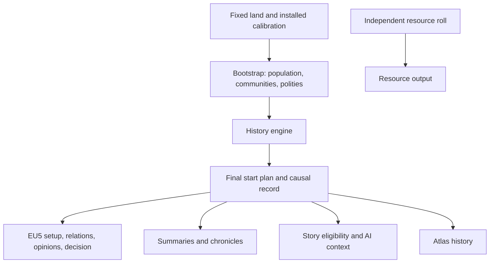

# RNW 1.2.0 plan: history, geopolitics and distinctive societies

**Status: accepted plan (owner instruction, 2026-11-02).** The owner asked for the
plan to be completed without open questions and committed. It is the design
reference for 1.2.0 work. **Implementation was authorized by the owner on
2026-11-03.** Version/epoch changes follow the phase requirements below;
publication still requires explicit authorization under [AGENTS](../AGENTS.md).
A later decision recorded in this file replaces the
earlier one. Values marked *calibrated* are tuned within their stated bounds
without a new decision; thresholds in [§18](#18-acceptance-criteria) change only
through a recorded decision.

Prepared against commit `de0914f`, RNW 1.1.0 (epoch 60) and EU5 1.4.6 / Steam build
26300913. When 1.2.0 ships, the shipped behavior moves into the subsystem documents
([native societies](natives.md), [content plan](content-plan.md)) and this plan
moves to `docs/archive/`.

## 1. The promise

At the 1337 start, the New World should look like a region whose societies have
already lived together. Its borders, alliances, rivalries and dependencies have
recorded causes. Its countries organize power differently. A small society has a
history just as an empire does. A quiet region is a valid result.

**Thesis:** generate a causal political past, project its surviving consequences
into EU5, and let the player read those causes in the game and in the generator.
The same model drives all three. Prose is an output of the model, never its record.

### What the player gets in 1.2.0

In the game, from the first day:

- borders, seats and subjects produced by recorded unions, conquests, separations
  and protection;
- governments and societal-value positions produced by the polity's own history;
- alliances, rivalries and confederations caused by recorded pacts, disputes and unions;
- **named historical opinions** in the diplomacy view, such as *Loss of Tlacoyan (1282)*
  or *Old Defence Pact (1197)*. Vanilla uses the same kind of record for country
  pairs (`opinion_historical_friend_POL_LIT`, [§2](#2-evidence-base));
- an **Our History** decision, which opens the country's chronicle when the player
  chooses. The AI never takes it, and no events fire at game start.

In the generator, after the world is revealed: a country summary, a short
chronicle, the reasons behind each relationship, and a regional overview.

## 2. Evidence base

### Code reused

| Component | Provides | Role in 1.2.0 |
|---|---|---|
| [`societies.py`](../src/rnw/societies.py) | Contact graph, food potential, hearths, complexity, population, culture/religion zones, states, tribes, markets | Bootstrap: physical opportunity, population, identity, organized-land envelope |
| [`eu5_natives.py`](../src/rnw/eu5_natives.py) | Calibration, identities, tags/names, countries, `vassal_pairs`, `_empires`, `_archetypes` | Split into bootstrap inputs, the final start plan and writers ([§12](#12-existing-static-systems)) |
| [`archetypes.py`](../src/rnw/archetypes.py), [`eu5_archetypes.py`](../src/rnw/eu5_archetypes.py) | Structure predicates, templates, positions, confederation output | Eligibility for trajectories; projection adapters for their outcomes |
| [`eu5_empires.py`](../src/rnw/eu5_empires.py), [`eu5_technology.py`](../src/rnw/eu5_technology.py) | Empire level/rank, roads, fear/resentment opinions, technology checks | Projection adapters; opinions now come from simulated memory |
| [`content.py`](../src/rnw/content.py), [`storymodel.py`](../src/rnw/storymodel.py), [`eu5_story.py`](../src/rnw/eu5_story.py) | Story eligibility, event graphs, translated static text, hidden binding events | Eligibility reads plan facts; event/localization pattern for the chronicle |
| [`eu5_ai.py`](../src/rnw/eu5_ai.py) | AI context from neighbours, allies, rivals, threats, subjects | Reads the final plan |
| [`layers.py`](../src/rnw/layers.py), [ADR 0010](adr/0010-layered-worlds-and-a-generator-of-its-own.md) | Separate land, resources and peoples | History belongs to peoples |
| [`atlas.py`](../src/rnw/atlas.py), [`worldfile.py`](../src/rnw/worldfile.py) | Atlas (`format` 2), `atlas.json` member limit 32 MiB, world total 100 MiB | Atlas `format` 3 with a bounded history section |
| [`wording.py`](../src/rnw/wording.py), [localization](localization.md) | Gender/genitive agreement for generated names; generic noun before a generated name in inflected languages | Chronicle and opinion templates |
| [`rng.py`](../src/rnw/rng.py), [`app/worldcode.py`](../src/rnw/app/worldcode.py) | Named integer streams; append-only `CHANGE_FIELDS` | Simulation draws; the new turbulence field |

### Reference scale [V-LOCAL, 2026-11-02]

The current reference world `rnw_exp_reference_verified_01311` has 5,098 land
locations, 307 states holding 1,121 locations, 320 tribes holding 1,676, four
great empires of 40, 71, 45 and 56 locations, 35 vassals and a largest ordinary
state of 11 locations. Its `atlas.json` is 804 KiB. Sixty rounds over this world
amount to about 306,000 location updates and a few hundred actors per round.

### Installed game survey [V-LOCAL, EU5 1.4.6 / 26300913, 2026-11-02]

Read-only inspection; no game was launched. Counts exclude commented lines. The
[claims ledger](research/claims-ledger.md) indexes this survey as C470.

| File (under `game/`) | SHA-256 prefix | Observed |
|---|---|---|
| `main_menu/setup/1337/12_diplomacy.txt` | `5b817a56fe72093b` | 649 `dependency` (402 `vassal`, 126 `tusi`, 68 `tributary`, …), 22 `scripted_mutual` alliances, 9 `scripted_oneway` (5 `guarantee`, 3 `embargo_nation`, 1 `trade_access`) |
| `main_menu/setup/1337/18_opinions.txt` | `ffa73fdde1ece3c4` | 86 opinion records, including `opinion_good_relations` (19), `border_aggression` (11), `opinion_threatens_conquest` (3), `recent_conflict_lost` (2) and the pair-specific `opinion_historical_friend_POL_LIT` (2) |
| `main_menu/setup/1337/20_rivals.txt` | `777b28ee7bf9a2ef` | 45 directed rival records |
| `main_menu/setup/1337/15_international_organizations.txt` | `9398a1ec20955804` | 53 organization records |
| `main_menu/setup/1337/16_wars.txt` | `43be6696391d7f83` | War/civil-war records and 10 truces |

- `in_game/common/biases/07_opinion_from_start_up.txt` defines start-up opinions,
  including pair-specific ones (`opinion_historical_friend_POL_LIT`: `value`, `min`
  and `max` of 50), localized in `opinions_l_english.yml` (*Historical
  Polish-Lithuanian Friendship*). Event opinions use `value` and `yearly_decay`:
  `recent_conflict_lost` −40/3, `border_aggression` −25/1, `opinion_good_relations`
  +50/1, `opinion_sent_help` +20/1.
- `in_game/common/societal_values` defines 17 axes; the generator already writes
  per-country positions within the range vanilla American templates reach and
  excludes axes whose definitions hold an age (`eu5_archetypes.AXES`).
- `in_game/common/decisions` exists in vanilla; the world mod currently edits
  vanilla decisions (`content_decisions`) but writes none of its own.

**Not established [UNKNOWN]:** that the engine loads a mod-defined start-up opinion
for generated tags, a mod-defined decision, or a `guarantee` between generated tags.
[§11](#11-eu5-projection) assigns each a decided fallback, so the plan does not wait
on these observations.

## 3. Decision register

| # | Subject | Decision |
|---|---|---|
| D1 | Promise | Causal history that changes the start state and is readable in game and generator |
| D2 | Period | 1037–1337, 60 rounds of five years; fixed, not a player setting |
| D3 | Scope of actors | Generated New World actors only; preserved Old World and vanilla island groups are fixed context ([§4](#4-scope-and-abstractions)) |
| D4 | Layer | History is part of peoples; it never reads the resource roll |
| D5 | Population | Start budget conserved through history; movement only, no births or deaths |
| D6 | Organized land | The bootstrap's landed/tribal/unorganized partition is fixed; ownership changes only among landed actors |
| D7 | State size | Emergent; calibrated to the 1.1.0 outcome of the same settings ([§7](#7-bootstrap-and-calibration)) |
| D8 | Extraordinary peoples | `empire_permille` seeds trajectories; history decides whether they last ([§12](#12-existing-static-systems)) |
| D9 | Social depth | Eight dimensions, each with a cause in history and a projection or a summary line ([§6](#6-societies)) |
| D10 | In-game visibility | Pair-specific named historical opinions plus the voluntary **Our History** decision; vanilla-key fallback |
| D11 | Relations in EU5 | Vassals, alliances, rivals, confederations, opinions, discovery: core. `guarantee`: core with fallback. Claims, cores, truces, starting wars, tributaries, dynasties, formables, ruins: not in 1.2.0 |
| D12 | Existing systems | Refactored first into a final start plan with byte-equal output (H1), then fed by history |
| D13 | Reading surface | Generator atlas in both windows; in-game opinions and chronicle; structured chronicle text, not free prose |
| D14 | Player control | History always on; one new control, **Historical turbulence** (Calm/Varied/Turbulent), field `natives.turbulence_permille` |
| D15 | Atlas | `format` 3 with a `history` section inside `atlas.json`; formats 1/2 stay readable and show no history (implementation correction below) |
| D16 | Stories | Existing families read plan facts; no new story family in 1.2.0 |
| D17 | Technology | Unchanged derivation: templates by complexity, the calibrated level for realized great empires |
| D18 | Engine check | One batched owner sitting at H7; fallbacks decided in advance |
| D19 | Scope cuts | Fixed order in [§17](#17-phases-and-scope-control) |
| D20 | Release | MINOR 1.2.0; pending epoch 61 from the first world-byte change (H4) |

## 4. Scope and abstractions

- **Rounds.** Each round covers five years. A conflict episode resolves within one
  round and leaves a settlement, a transfer, a dependency or a grievance. Events are
  dated to their round's first year; text never claims a day or month.
- **Fixed physical world.** Rivers, coasts, terrain and the accepted wrap topology
  do not change. Social routes, settlement emphasis and political boundaries do.
- **Bootstrap, not genesis.** The world of 1037 is already inhabited. The period
  covers political memory and institutional change, not first settlement, the
  origin of farming or the ancestry of peoples.
- **Graph, not pixels.** History runs on locations, communities, polities and
  sparse contacts, never on map pixels or all country pairs.
- **Preserved actors.** Old World countries and preserved vanilla island groups
  are fixed context. Generated actors cannot take their land, hold memories of
  them or receive relations with their tags (the existing verifiers already forbid
  vanilla tags in generated opinions). Overseas Old World settlement stays a
  separate future direction.
- **Same rules to the end.** No early stop when a desired picture appears, no
  reroll for a preferred empire, no forced peace in the last round.

## 5. Layers and controls

History reads land, climate, food potential, river valleys, physical coasts and
reachable contacts. It never reads RGO assignments, precious-resource settings or
resource weights. A resource reroll leaves the history digest equal; a peoples
reroll changes societies and their past together. There is no separate history
reroll in 1.2.0.

| Control (world-code field) | Meaning in 1.2.0 |
|---|---|
| Population scale (`population_permille`) | Unchanged start budget and rounding; history moves cohorts and conserves the total |
| Hearths (`hearths_per_10k`, `hearth_reach_steps`) | Unchanged: centres of complexity and their reach; they supply bootstrap capacity |
| Land in states (`state_share_permille`) | Unchanged organized-land envelope; history changes its owners only (D6) |
| State spread (`state_spread_permille`) | Unchanged share of lone bootstrap states away from hearth clusters |
| Mean state size (`state_locations`) | Bootstrap scale and calibration target ([§7](#7-bootstrap-and-calibration)); conquest may produce larger states |
| Culture/religion zone size | Unchanged identity geography; migration adds minorities; political and faith borders may differ |
| Tribe size, organized tribes (`tribe_locations`, `organized_permille`) | Unchanged partition into pop-type tribes, landed actors and unorganized land |
| Extraordinary peoples (`empire_permille`) | Per-hearth chance of an extraordinary trajectory; 0 seeds none and leaves ordinary history on |
| Peasant share (`peasant_peak_permille`) | Unchanged maximum at full complexity; history never changes it |
| **Historical turbulence** (`natives.turbulence_permille`, new) | Propensity for pressure, conflict and shocks within viability rules ([§15](#15-player-control-and-world-codes)) |

The help text of **Extraordinary peoples** changes from "rises" to "starts a
trajectory that history may sustain or end", in every language.

## 6. Societies

`complexity` stays the calibrated input for population, peasants and technology.
It no longer stands for everything else. Eight dimensions belong to a polity at a
given time. Each changes through recorded events, drives choices in the simulation,
and appears in the game or in the summary. An internal score with neither is not added.

| Dimension | Drives in history | EU5 projection |
|---|---|---|
| Centralization | Reach, integration cost, succession risk | `centralization_vs_decentralization` |
| Authority (ruler, council, sacred, customary) | Who bargains for unions and reforms | Government type and `heir_selection` among usable templates |
| Livelihood (concentrated farming, mixed, mobile) | Capacity, pressure, migration | Existing landed/tribe/unorganized representation, settlement rank and development writers |
| Exchange orientation (overland, coastal, inward) | Contacts and exchange agreements | `land_vs_naval`, markets and ports |
| Religious authority | Mediation and sacred disputes | `spiritualist_vs_humanist`, `mysticism_vs_jurisprudence`, theocracy, holy sites |
| Military posture | Conflict choice and commitments | `offensive_vs_defensive`, `belligerent_vs_conciliatory`, `quality_vs_quantity` |
| Integration | Cost of conquest, place of minorities | Mixed pop cohorts |
| Institutional tradition | Credibility of agreements, resistance to reform | `traditionalist_vs_innovative` |

**Projection rule.** H0 reads each named axis from the installation. An axis is
projected only if it holds no age and vanilla American templates give it a range.
Otherwise its dimension stays internal and appears in the summary only. Positions
never leave the vanilla American range, and a missing axis fails the build, as
`eu5_archetypes` already does. No dimension is a flat bonus. A donor culture or
religion is an identity mapping, not an advantage.

**Principles.** Geography offers opportunities and friction; it does not dictate a
government. Related societies can diverge and unrelated ones converge. Conquest
never changes a population's culture or faith. Tribes and unorganized communities
act through movement, exchange, resistance and common defence; they are never
turned into landed countries to colour the map. Federations, trading networks and
stable small states are end states in their own right, not steps toward empire.

## 7. Bootstrap and calibration

1. Physical opportunity and cost: land contacts, islands, passes, coastal access,
   wrap topology.
2. Population, identity cores and cohorts from the existing calibration.
3. The organized-land envelope and agrarian-viable seats from the existing rules;
   tribal and unorganized land in its existing representation.
4. Bootstrap polities: the existing state construction with its mean size scaled
   by a *calibrated* bootstrap factor `b` in [0.4, 1.0]. So 1037 holds more,
   smaller polities, which history unites, conquers and divides.
5. Social profiles and contacts. Shared culture does not imply knowledge of an
   unreachable country.
6. Extraordinary trajectories seeded per hearth from `empire_permille`.
7. History; then one final start plan; then every output.

**Inverse calibration.** The final distribution must match what the sliders mean
without any repair after history. `b` and the action propensities are fitted on
the published seed set ([§18](#18-acceptance-criteria)), with the 1.1.0 outcome of
the same seeds and settings as the reference. They are then validated once on
the held-out set. Each world's deviation is reported, never corrected. The targets
are statistical over seed sets, not per world.

**Population.** History moves cohorts along feasible routes into available
capacity. The total equals the start budget at every round. The 1037 population is
therefore an abstraction of the same people, not a demographic estimate, and the
summary does not claim historical numbers, deaths or births.

## 8. One round

Synchronous transitions: every actor evaluates the same prior snapshot.

1. **Conditions.** Update capacities, pressures and agreement obligations; decay
   memories by elapsed years.
2. **Contacts.** Derive reachable partners from physical access and existing
   exchange. Sea reach uses physical coasts and a *calibrated* maximum number of
   sea steps; a shared sea-zone label is not access.
3. **Proposals.** Each actor ranks at most three locally feasible actions.
4. **Arbitration.** Incompatible proposals are resolved by priority, then by a draw
   from the named stream. Population, territory and commitments are reserved once.
5. **Transition.** Ownership, dependencies, memberships and commitments change
   together; invariants are checked.
6. **Record.** Append events with causes, update memories, invalidate only the
   affected summaries.

Every action has prerequisites, a cost, a transition, refusal and failure outcomes,
and a cause. At most one shock per region per round. A shock exposes an existing
vulnerability; it does not pick a winner.

### Event families

| Family | Cause | Consequences that can last to 1337 |
|---|---|---|
| Union | Viable neighbours and an institutional bargain | New polity, member autonomy, obligations |
| Exchange agreement | Reachable complementary centres, repeated contact | Trust, shared route interest |
| Defence pact | A demonstrated threat and the ability to cooperate | Alliance, obligations, fear of a third party |
| Conflict | Reachable target, grievance or opportunity, capacity | Transfer, settlement, grievance, dependence |
| Submission or protection | Power imbalance and negotiated survival | Vassal or protection ([§11](#11-eu5-projection)) |
| Failed integration | Distant rule, weak legitimacy, local organization | Autonomy, separation, successor lineage |
| Succession crisis | A succession rule and existing tensions | Continuity, redistribution or division |
| Religious mediation or dispute | A real centre and competing authority | Cross-border contact, settlement or rivalry |
| Migration or refuge | Pressure at origin, capacity at destination | Moved cohorts, minorities, shared memory |
| Institutional reform | A repeated problem and an eligible response | Changed dimension, its cost and resistance |
| Reconciliation | Time, cooperation, a changed balance | Less grievance, restored trust |

Positive and negative feedback both apply. Conquest adds power and administrative
burden. Cooperation builds trust and dependence. A defeated polity can recover
through allies or autonomy. A different faith is never a war order by itself.
Extermination and mortality are outside the model.

## 9. Conflict and integration

The abstract strength of a side combines mobilizable population, food support,
coordination, technology, travel cost, defensible approaches, allies' commitments
and distance from the seat, resolved with bounded integer uncertainty. It does
not simulate EU5 armies or predict campaign battles.

- Reach costs. River valleys ease travel only along verified contact; physical
  straits and wrap contacts use their accepted connectivity.
- Each actor has a commitment budget. Allies cannot commit fully to several
  conflicts at once.
- Occupation, annexation, submission and influence are distinct. Annexation is
  not always the best outcome.
- Distant, heterogeneous or recently gained districts cost more to integrate.
- Collective defence needs reachable members and an actual commitment; it is not
  a world-wide brake on a large state.
- A partition creates connected successors with viable seats at construction.
- Dependency graphs stay acyclic.
- A stable polity can stay stable; collapse is not a variety mechanism.

## 10. Relationships and memory

Memory is directed. The victor and the loser remember a war differently; a
protected polity can value protection and resent dependence at once.

| Factor | Built from |
|---|---|
| Trust | Kept agreements and cooperation |
| Grievance | Losses, broken bargains, contested authority |
| Fear | Shown ability and apparent intent to threaten |
| Dependence | Benefits and vulnerability tied to a partner or route |
| Competition | Overlapping territorial, religious or political aims |
| Affinity | Shared experience and institutions |

Each memory has a date, a cause, a weight and a *calibrated* decay; renewed
conflict refreshes an old grievance. An early war does not leave permanent
maximum hostility. An agreement forms only after the simulation resolves the
bargain; no opinion is added afterwards to make an alliance legal.

**Patterns to expect, not quotas:** successor states of a real union, an uneasy
protector and client, small states against a growing neighbour, a league with a
dominant hub, reconciled enemies, a sacred centre between rivals, related rivals,
a durable union of different communities, a contested pass, refuge communities,
coastal and inland rivals, a long peace, a declining centre, a newly united realm,
an isolated island society. Patterns overlap; a region is never one scenario.

## 11. EU5 projection

The final start plan owns every projected fact. Writers, verifiers, story
eligibility and AI context read it; nothing reads written EU5 text back into the
model, and nothing adds a second set of relations later.

| Consequence | Route | Disposition |
|---|---|---|
| Ownership, seats, pops, identity | Existing native writers | Core |
| Government, positions, rank, technology | Existing calibrated adapters ([§6](#6-societies), D17) | Core |
| Vassals | Existing subject output and technology checks | Core |
| Alliances, rivals | Existing `scripted_mutual` and `20_rivals` writers; `alliance_can_exist` prerequisites | Core |
| Confederations | Existing `tribal_confederation` output for landed tribes | Core |
| Discovery | Existing helper: every holder discovers its partner's capital area | Core |
| Markets, settlement ranks, development, roads | Existing writers, recomputed from the plan | Core |
| AI context | `eu5_ai` from the plan | Core |
| Named historical opinions | New: a world-generated bias file and its localization | Core, with fallback F1 |
| Our History decision and chronicle event | New: a world-generated decision, event and localization | Core, with fallback F2 |
| Protection without subjecthood | `scripted_oneway` `guarantee` (5 vanilla precedents) | Core, with fallback F3 |
| Exchange agreement | Named opinion, markets and roads | Core; `trade_access` not used |
| Tributary dependence | Blocked: `tributary` needs a tribal or horde overlord (C158) | Memory and named opinion only |
| Claims, cores, truces, starting wars, dynasties, rulers, inheritance formables, ruins | — | Not in 1.2.0 ([§20](#20-beyond-120)) |
| Extinct predecessors | History and text only; no dead tag in a live scope | Core as context |

**Named historical opinions.** Each projected memory between two living generated
countries becomes one bias definition, as vanilla's pair-specific friendships are.
Its key is `rnw_hist_<n>`. Its family sets its value and `yearly_decay` within the
vanilla start-up band (|value| ≤ 50, `yearly_decay` 1–3), so it fades in the
campaign like vanilla start-up opinions. Its localized name gives the cause and the
year: *Loss of Tlacoyan (1282)*. Limits: at most four per directed pair and 2,000
per world. The named opinions of an allied pair sum to 0 or more in each direction,
checked at construction, so an alliance can carry an old suspicion without
breaking `alliance_can_exist`.

**Our History.** One decision, visible only to countries listed by a generated
scripted trigger, with `ai_will_do = 0`, opens one event. Its description is the
country's chronicle from a per-country localization key. There is no game-start
event and no cost.

**Fallbacks**, applied if the H7 sitting or a log shows failure; each is disclosed
in [known limitations](known-limitations.md):

| ID | Failure | Fallback |
|---|---|---|
| F1 | Mod-defined bias rejected or not shown | Map families to vanilla start-up keys with setup precedent: grievance → `recent_conflict_lost` / `border_aggression`; fear → `opinion_threatens_conquest` / `opinion_prey_to_conquest`; resentment of an overlord → `opinion_tyrant_overlord`; trust → `opinion_good_relations`; protection received → `opinion_sent_help`; friction → `opinion_irritated` |
| F2 | Decision or event not shown | Remove both; the chronicle stays in the generator; named opinions remain the in-game reasons |
| F3 | `guarantee` between generated tags rejected | Protection projects to a named opinion (or `opinion_sent_help` under F1) |

New formats used here (biases, decisions, the chronicle event) are recorded in the
[interoperability register](research/interoperability.md) in H0.

## 12. Existing static systems

`_empires`, `_archetypes`, `vassal_pairs` and their verifiers carry calibrated,
game-evidenced behavior (C160, C251, `alliance_can_exist`). They are not discarded:

1. **H1 extracts the plan.** The current static pipeline is refactored into
   bootstrap → `FinalStartPlan` → writers, with world bytes and goldens equal. No
   epoch changes. Existing verifiers read the plan.
2. **Trajectories replace placement.** `empire_permille` seeds, per hearth, one
   trajectory among those its domain is eligible for, using the current structure
   predicates as eligibility:
   - **great empire:** an ambitious centre with high centralization and capacity;
   - **sea league:** ports inclined to exchange and defence pacts and to council rule;
   - **highland confederation:** tribes inclined to common defence;
   - **sacred centre:** strong religious authority at the zone's most populous centre.

   A **fractured realm** cannot be seeded. It exists only as the successors of a
   recorded union.
3. **Outcomes are recognized, then projected.** At 1337 the structure predicates
   recognize realized outcomes. The existing adapters write their templates,
   positions, confederations, levels and rank. Rank stays reserved for realized
   great empires, following the vanilla Americas.
4. **Relations come from memory.** Fear and resentment opinions replace the
   blanket "every neighbour fears the empire" rule. Leagues' alliances follow
   actual pacts rather than a ring. Groups may overlap through explicit memberships.
5. **Design rules are reviewed one by one.** Internal design rules (the ring, the
   disjoint groups, the single `archetype` label, the `STATE`-only story
   eligibility) are kept or replaced with new tests. Proven engine prerequisites stay.

The report counts seeded and realized trajectories per kind.

## 13. Reading surfaces and language

**Generator.** The country summary covers origin, organization, present position
and two or three relationships with reasons. The chronicle lists up to eight
events (fewer for a quiet past) with periods, partners and place links. The
relationship view separates the model's memory from the projected EU5 relation.
The regional overview shows major changes and shared inheritances. The Tauri
window and the classic window show the same facts through the common controller;
the classic layout may be more compact.

**Structured text.** A chronicle entry is a period, an event family, one to three
actors and an optional place, rendered from a template. Each family has two or
three templates per language, and variety comes from the causes, not synonyms.
Inflected languages follow the existing rule of a generic noun before a generated
name. Templates are original English source text, translated through the existing
catalogue pipeline into every official language read from the installation. The
model stores typed events, never a paragraph. The generator renders in its
interface language at view time; the export renders the game's chronicle and
opinion names into all game languages. Text claims only what the model holds:
no personalities, named battles, doctrines or death tolls.

## 14. Atlas, portability and spoilers

- Atlas `format` 3 adds a `history` key inside `atlas.json`, with no new archive
  member. It holds living actors and the extinct actors needed to explain them,
  lineage, chronicle events, the causal closure of every projected fact, and
  sparse ownership changes. It never holds per-round rasters.
- Budgets: 2 MiB of history for the reference world, and a validator cap of 8 MiB
  (`atlas.json` limit 32 MiB; current reference 804 KiB). There are explicit caps
  on actor, event and string counts, nesting and reference depth. Import checks
  chronology, references and the absence of causal cycles.
- A `format` 1/2 world shows "no recorded history" and nothing is invented for it.
  An older application rejects `format` 3 explicitly.
- Covered worlds reveal no names, counts, neighbours, chronicle titles or political
  structure through summaries, hover text, search or file metadata. History is
  revealed with the world's existing reveal action.
- Ownership replay, network and lineage views are after 1.2.0.

**Implementation correction, 2026-11-04:** the existing source already uses atlas
format 2 for structured names (L1), and its reader ignores unknown object fields.
Reusing that number would let an older application silently discard history.
Format 3 preserves the intended rejection boundary while retaining readers for
both earlier formats. This changes the internal format number, not the promised
reading capabilities or the public backward-compatibility contract.

## 15. Player control and world codes

- History is always on for new generations. An off switch would mean maintaining a
  second generator; 1.1.0 worlds and the 1.1.0 release remain available. Calm
  regions and isolated communities are normal results.
- **Historical turbulence:** a quick choice on the World tab, Calm / Varied /
  Turbulent = 200 / 500 / 800 permille, and the same setting as a slider from
  0 to 1000 in **Advanced → Peoples** (**Customize** in the classic window).
  Default Varied (500). **Total Chaos** draws it within the range. It changes the
  propensity for pressure, conflict and shocks within viability rules. It never
  changes the strength of the country the player will choose, and it does not
  promise a number of wars.
- `natives.turbulence_permille` is appended to `CHANGE_FIELDS`. A code without it
  means 500. Older codes keep the existing older-algorithm warning.

## 16. Architecture and determinism

| Responsibility | Placement |
|---|---|
| Bootstrap primitives | Refactored parts of `societies.py` |
| Entities, events, typed effects | New game-independent `history_model` |
| Rounds, arbitration, sparse updates | New game-independent `history_engine` |
| Invariants and causal checks | Shared validators, at each round and at the final boundary |
| Final start plan and projection | `eu5_natives.py` with a focused `eu5_history` adapter |
| Written-output checks | Existing exporter verifiers reading the plan |
| Chronicle and opinion text | A presentation module reading immutable events |
| Viewer and persistence | `atlas.py`, `worldfile.py`, controller/bridge, both windows |

`eu5_nw_export.py` does not become the engine. Arithmetic is integer or fixed-point.
IDs are canonical and ties break stably. Draws derive from the peoples seed, the
action family, the round and the actor IDs. Wording, diagnostics, language,
iteration order and worker count never change world bytes; Python hash order and
wall-clock time never reach IDs or decisions. Cancellation is checked within
rounds; cancelled generations leave existing worlds untouched, as now. Resuming
halfway through history is not needed.

## 17. Phases and scope control

| Phase | Deliverable | Exit evidence |
|---|---|---|
| H0 Contracts | Slider contracts ([§5](#5-layers-and-controls)); axis inventory ([§6](#6-societies)); bias, decision, event and `guarantee` formats; register entries; seed sets; 1.1.0 baseline metrics and timings | Written inventory and baselines; no world bytes change |
| H1 Plan extraction | `FinalStartPlan` between construction and writers; verifiers read it | Goldens and reference digests equal; no epoch |
| H2 History core | Model, rounds, arbitration, contact/union/conflict/dependency/separation, directed memory, causal validator | Synthetic fixtures pass; the *divided valley* fixture reproduces |
| H3 Societies | Eight dimensions, reform, trajectories, conservative migration | Profiles diverge with history; identity survives conquest |
| H4 Projection | Plan from history; all core consequences ([§11](#11-eu5-projection)); named opinions; decision; economy, roads, discovery, AI | Model and written output agree; pending epoch 61 and goldens |
| H5 Reading | Atlas `format` 3, both windows, structured text in every language, spoilers | Covered/revealed, import and recovery flows; 1.1.0 worlds read |
| H6 Continuity | Existing story eligibility from plan facts; clean end of obsolete bindings | Content tests; no new family |
| H7 Calibration and delivery | Thresholds on both seed sets, performance, reference world, package self-test, candidate install, hub update, one owner sitting, fallbacks if needed | [§18](#18-acceptance-criteria) met; release notes |

Order: H0 → H1 → H2 → H3 → H4 → H5/H6 → H7. Viewer work in H5 can start from the
H2 schema.

### Implementation progress

- **H0, 2026-11-03:** [contracts and baseline](research/history-contracts.md)
  record the installed axes and text interfaces, control contracts, published and
  held-out seed sets, and 24 bootstrap-only baseline measurements. Full-world
  statistical acceptance remains H7 work; held-out seeds have not been used.
- **H1, completed 2026-11-03:** `eu5_start.FinalStartPlan` holds countries, typed
  population cohorts and all existing setup facts. `build_start_plan` supplies it
  through the existing static construction. EU5 writers, output verifiers,
  development, content, AI and the atlas read that boundary. Population script
  is serialized only at output; current largest-cohort atlas and aggregated
  content identity rules remain distinct. No history simulation is enabled yet.
  [V-EXEC] Locked sync and `make check` pass (2,455 Python tests, 15 optional
  skips; strict types, format/lint, 23 Rust tests), as do the 13 read-only
  installed-game checks and generated content-reference check. The final-source
  reference export reproduces all 868 nonmetadata files, digest
  `e4914d9bbfce5c7fedb76573fc228b4c195b4453130456500f30ea3e9d73f6aa`;
  frozen goldens, version 1.1.0 and epoch 60 are unchanged. Source-only foundation;
  candidate/hub delivery remains H7.
- **H2, completed 2026-11-03:** the [offline history core](history-core.md)
  supplies immutable actors/cohorts, sparse ownership and lifecycle changes,
  simultaneous proposals/arbitration, local contacts, unions, conflicts,
  dependencies, protection/pacts, division, sacred access and directed decaying
  memory. Causal validation replays the complete record. The 60-round divided
  valley and autonomous synthetic cases pass; the exporter still uses H1's static
  plan. [V-EXEC] All 38 history cases pass, including causal replay, joint unions,
  resource reservations, permuted inputs and cancellation. Locked sync and
  `make check` pass (2,493 Python tests, 15 optional skips; strict types,
  format/lint, 23 Rust tests). Source-only core: no world-byte or epoch change,
  new game-format writer, candidate or hub installation. Performance calibration
  and the public history record remain later phases, as scoped in the core guide.
- **H3, completed 2026-11-03:** [society profiles and transitions](history-core.md)
  add all eight dimensions, experience-based reform with costs/resistance,
  integration burden, eligible per-hearth extraordinary ambitions and recognition
  of actual outcomes. Conservative cohort movement preserves every identity and
  peasant budget, including through conquest. Tribes can establish common defence
  after actual pressure without becoming landed. [V-EXEC] All 77 history cases and
  full checks pass (2,532 Python tests, 15 optional skips; strict types, format/lint,
  23 Rust tests); permuted inputs and hash seeds 1/927 agree. The internal history
  digest now includes profiles and settlements; released world goldens, bytes,
  version and epoch remain unchanged. Source-only delivery still belongs to H7.
- **H4, first part completed 2026-11-03:** the [bootstrap boundary](history-core.md#eu5-bootstrap-boundary-h4-first-part)
  constructs 1037's ordinary polities, uses bounded physical water paths,
  includes post-diaspora cohorts and unorganized communities, and supplies the
  installed agrarian/technology prerequisites. Migration projects back to exact
  typed cohorts, conserving every pop-type/culture/faith budget through political
  changes. The size factor is provisionally 1, with no H7 calibration claim.
  This part supplies the inputs for final-plan construction; the exporter still uses H1.
- **H4, second part completed 2026-11-03:** the [final-plan projection](history-core.md#final-start-projection-h4-second-part)
  constructs surviving ownership, governments, bounded positions, actual relations
  and causal named-opinion records in one `FinalStartPlan`, with independent
  checks. It preserves overlapping historical memberships, recomputes centres,
  roads/discovery and supplies the AI context. The constructed 256-location flow
  reaches this plan. The third part supplies its localized text artifacts below.
- **H4, third part completed 2026-11-03:** [localized history artifacts](history-core.md#localized-history-artifacts-h4-third-part)
  supply bounded causal chronicles, original named opinions, the voluntary decision
  and conditional chronicle event, plus directed guarantee records. All 59 new
  sources are translated through the existing eleven-language pipeline. Parsed
  artifact checks reject changed effects/scopes and missing localization bindings.
  Full checks pass (2,653 Python tests, 17 optional skips; strict types, format/lint,
  23 Rust tests), as do 15 installed-game read-only checks. Complete text artifacts
  agree under hash seeds 1/927. The fourth part connects them to generation.
- **H4, integration completed 2026-11-04:** the [normal export bridge](history-core.md#export-integration-h4-fourth-part)
  supplies all starts from physical bootstrap and history, including the installed
  effective governments. Historical setup/output checks preserve engine prerequisites
  while replacing static placement rules. Target 1.2.0 and pending epoch 61 are set;
  epoch 60's tagged reference is preserved unchanged. Full checks pass (2,674 Python,
  17 optional skips; strict types, format/lint, 23 Rust), with 15 read-only installed
  checks. The real native stage passes simulation/replay/projection; exact-input
  stage reuse then passes all output verifiers for 872 files, with the pending
  reference recorded. This establishes model/writer agreement, **not** an uncached
  timing, H7 performance thresholds or engine loading. Next: H5/H6; H7 retains
  calibration, final normal reproduction and candidate/hub delivery.
- **H5 foundation, 2026-11-04:** [compact causal state](history-core.md#compact-causal-state-h5-foundation)
  removes expired snapshot memory and redundant direct links while preserving
  all causal ancestors and real H4 outcomes. Context/reform caching and direct
  canonical JSON reduce repeated work. Full checks pass (2,683 Python, 17 optional
  skips, 23 Rust; strict types and lint). Portable history, both reading surfaces
  and controls remain H5 work; no H7 time/memory threshold is claimed.

- **H5, reading completed 2026-11-04:** [portable facts and shared reading](history-core.md#portable-reading-and-controls-h5)
  add atlas format 3, bounded import and ownership replay, localized society/profile,
  chronicle, relationship and regional panels in both windows, reveal protection and
  the turbulence control. Full checks pass (2,716 Python, 17 optional skips, 23 Rust),
  as do Tauri checks/build and 15 tests, browser flow, synthetic import/recovery and
  the classic dialog/place-link case. The reference native plan's portable record
  is 1.956 MiB and round-trips; H7 seed-set and performance acceptance remain separate.

- **H6, completed 2026-11-04:** [reviewed story bindings](content-plan.md#history-continuity-h6-120-development)
  use current landed countries, surviving cooperative relations and dependencies;
  landed confederates are eligible, pop countries are not. Existing geography and
  story limits remain, with causal report bindings and a runtime subject guard.
  No new family is added. Revised council prose and every translation avoid an
  invented past. Full checks pass (2,723 Python, 17 optional skips, 23 Rust) and
  15 read-only installed checks pass. The real reference's writers/output checks
  pass after exact-input reuse of its independently validated native stage; the
  pending epoch-61 golden is refreshed. Normal reproduction and delivery remain H7.

**The divided valley fixture (H2).** Three farming districts with viable seats in
1037 unite by 1112 through repeated cooperation. A dispute over obligations divides
them into three successors in 1227 without any change of culture. In 1282 the
downstream successor takes a border district from its upstream neighbour. In 1317
the third negotiates access to the shared sacred centre. In 1337: three related
polities with different institutions, a real former union, a grievance between two
of them (a named opinion) and a mediator.

**Irreducible core**, without which 1.2.0 does not ship: H0, H1, H2, H3's
dimensions that project, H4 core projection with named opinions (or F1), the
generator reading surface, every language, and H7.

**Cut order** when time or evidence runs short, first cut first:
1. Our History decision (as F2);
2. the regional overview;
3. `guarantee` (as F3);
4. migration beyond existing mixed-pop support (identities then stay where bootstrapped);
5. H6 (stories then bind as in 1.1.0, reading the plan);
6. internal-only dimensions (summary lines removed).

A cut is recorded here and in the release notes.

## 18. Acceptance criteria

**Seed sets** (recorded in H0): published = 6 presets (continents, supercontinent,
small continents, archipelago, islands, The Wall) × 4 seeds; held-out = the next 4
seeds of each preset, used only in H7. Slider sweeps cover low and high state
share, state size, population and extraordinary chance on two presets × two seeds.

**Hard, every world and every turbulence level:**

- Every living polity has valid members, seat, lifecycle and the agrarian and
  technology support its projection needs. Ownership is unambiguous.
- Population is conserved, never negative or duplicated. Dependencies are acyclic.
  Agreements meet eligibility, knowledge, opinion and capacity constraints.
- No event touches an actor outside its lifetime. Causes point backwards without
  cycles. Every projected fact has its causal chain, with no later contradicting
  event: **unexplained outcomes = 0**.
- Projected governments, positions, ranks and technology are within the installed
  contract. Final output and history agree without cleanup.
- Old World and preserved vanilla data are equal to 1.1.0 handling.
- Equal digests under permuted iteration, other worker counts and supported
  platforms. Resource rerolls leave the history digest equal; peoples rerolls leave
  land and resources equal. Language and diagnostics change no political digest.
- Spoiler tests pass in both windows. 1.1.0 worlds and library data read.
- Empty inputs (no population, no eligible landed actor, isolated components) give
  valid results without forced countries or diplomacy.

**Statistical, both seed sets, Varied unless stated:**

| ID | Measure | Threshold |
|---|---|---|
| S1 | Conflict, transfer and separation events per 100 bootstrap polities; continuity of 1337 landed countries whose polity, or a union it formed, is at least 100 years old | Event medians strictly rise Calm < Varied < Turbulent; continuity median ≥ 40% at Varied |
| S2 | Landed generated countries with at least one history-caused projected relation | Median ≥ 50% |
| S3 | Chronicle entries per landed country | Median ≥ 3; maximum 8 |
| S4 | Median ordinary state size against 1.1.0 on the same seed and settings | Within ±25% (±40% at Calm and Turbulent); rank correlation with the slider ≥ 0.9 in the sweep |
| S5 | Largest polity with its subjects on a landmass of ≥ 20 bootstrap polities | ≤ 50% of the landmass's state locations at Calm and Varied; reported at Turbulent |
| S6 | Distinct projected government/position combinations per world | Median ≥ 1.5 × the 1.1.0 median |
| S7 | Realized / seeded great-empire trajectories at `empire_permille` 250 | 30–90%; none seeded at 0 |
| S8 | Added generation time against 1.1.0, same machine and inputs | Median ≤ 15%, p95 ≤ 25% |
| S9 | Added peak memory, reference workload | ≤ 256 MiB |
| S10 | Cancellation latency | ≤ 2 s |
| S11 | History in `atlas.json` | ≤ 2 MiB reference, ≤ 8 MiB any seed-set world |

Distributions and outliers are reported, never a chosen best seed. Native code
is added only for a measured bounded kernel with an equal-output reference.

**Game-facing:** `uv sync --locked --group dev && make check`, desktop checks,
goldens, installed-game read-only checks and reference reproduction as in
[testing](testing.md). One owner sitting of about fifteen minutes on the H7
candidate covers: the world loads without errors naming the new keys; a named
historical opinion appears in the diplomacy view; Our History opens the chronicle;
a generated `guarantee` appears. A failure applies F1–F3, with no further sitting.

## 19. Risks

| Risk | Response |
|---|---|
| One state absorbs a continent | Reach, commitments, integration cost, coalitions; S5 |
| Constant fragmentation | Continuity has benefits; S1 continuity |
| All societies converge | Independent dimensions with costs; S6 |
| Sliders lose meaning | Fixed envelope, conserved population, S4 |
| History invisible in game | Named opinions and the decision with decided fallbacks; S2 |
| Rich but false text | Typed events, causal validator, template text |
| Refactor regressions | H1 byte-equal extraction before any behavior change |
| Engine rejects a new record | F1–F3 |
| Spoiler leaks | Covered-flow tests in both windows |
| Large or unsafe atlas | Caps, causal closure, import validation; S11 |
| Scope growth | Irreducible core and cut order ([§17](#17-phases-and-scope-control)) |

## 20. Beyond 1.2.0

Each item needs its own decision with its cost and evidence:

- claims, foreign cores and truces (generated-tag syntax and initialization);
- formables of political inheritance (tag lifecycle, no collision with existing formations);
- named rulers, dynasties and marriages (character entities before any prose);
- starting wars, recorded ruins and new assets;
- ownership replay, diplomatic network and lineage views;
- independent history rerolls and alternate pasts;
- new story families built on historical facts;
- endogenous population growth, settlement expansion and resource-driven politics
  (which revise the slider and layer contracts);
- millennia of settlement, language and religion divergence;
- hand-authored scenarios and fantasy histories.

Hydrology, fantasy land shapes, wrap research and interface work stay in the
[roadmap](roadmap.md#other-future-work-requested-by-the-owner).
